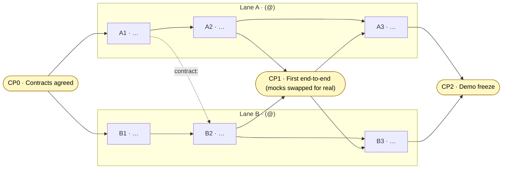
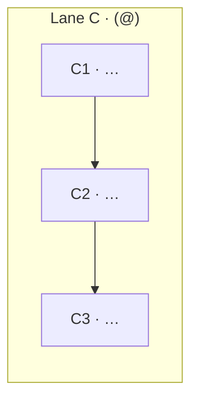

# Roadmap skeleton (what durhack-init / durhack-plan write into docs/roadmap.md)

One `subgraph` per lane, side by side (`flowchart LR` with `direction TB` inside each lane).
Checkpoints are shared nodes outside every lane: each lane's row that a checkpoint needs points
into it, and the first row after it comes out of it. A cross-lane dependency is a dotted arrow
from the giving row to the needing row, labelled with the contract name.

Row ids are the lane letter + number (`A1`, `B3`). Node text: `ID · short name`.
Classes (colour only, no emojis): `done` green, `wip` amber, `next` blue, `todo` grey, `owner` purple (owner decision), `cut` dashed, `cp` checkpoints.

## 2 lanes

## 3 lanes — add

with `CP0 --> C1`, `C2 --> CP1`, `CP1 --> C3`, `C3 --> CP2`.

## 4 lanes — add lane D the same way.

## Checkpoints (defaults; durhack-plan sets the times)

| CP | When (hours in) | Means |
| --- | --- | --- |
| CP0 | 1–2 h | Idea, prizes, architecture and `docs/contracts.md` agreed; every lane can start on mocks |
| CP1 | ~10 h | First end-to-end run on `main`: real pieces replace mocks across lanes |
| CP2 | ~18 h | Feature freeze: only fixes, polish, demo script, docs and judge prep after this |
| CP3 | ~22 h | Demo rehearsed, submission (Devpost etc.) filled in, video recorded if needed |
