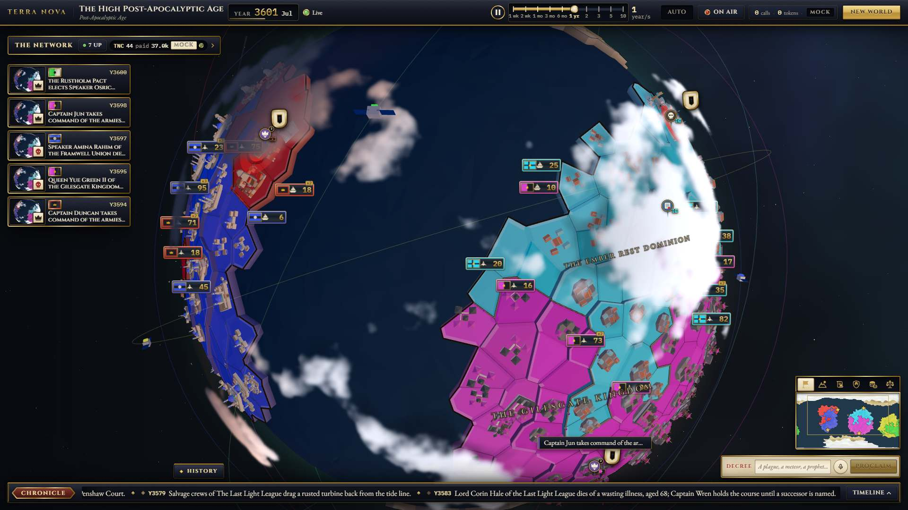
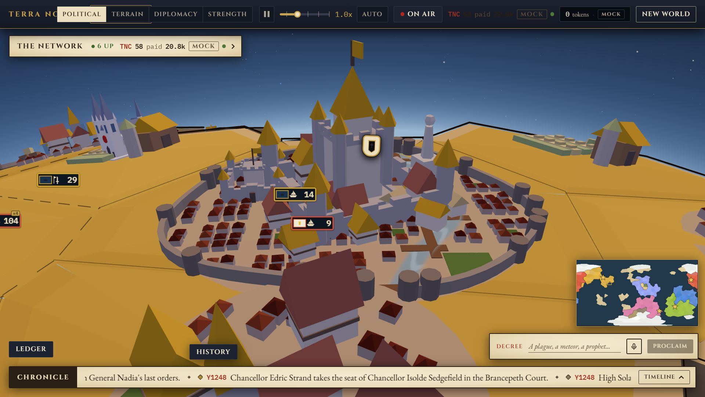
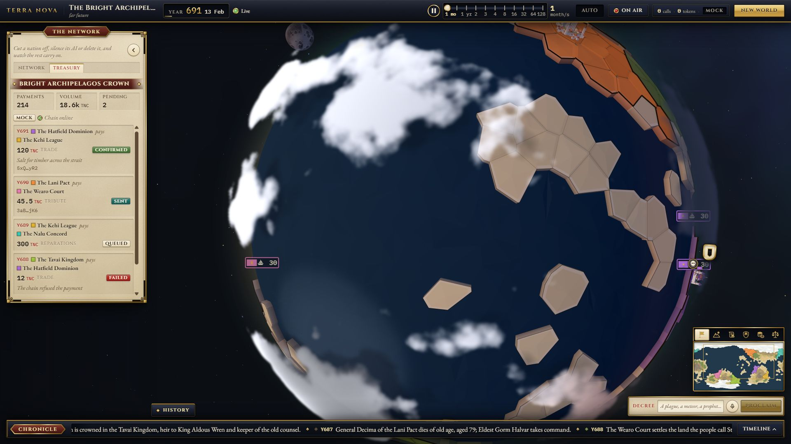
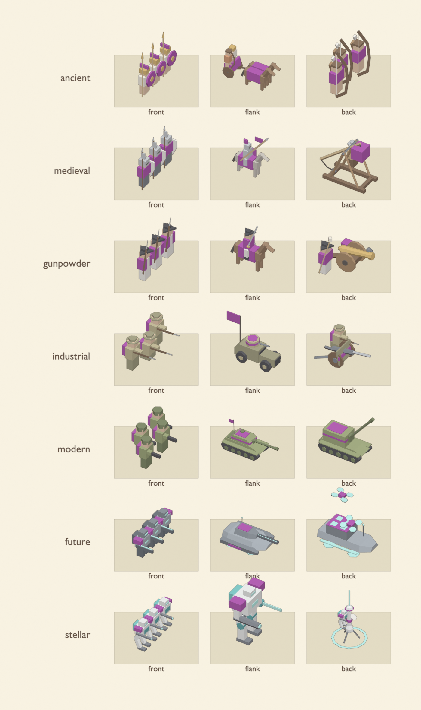
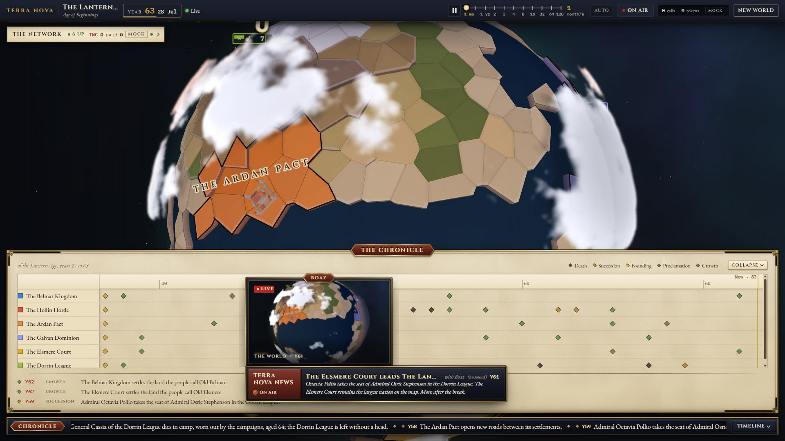
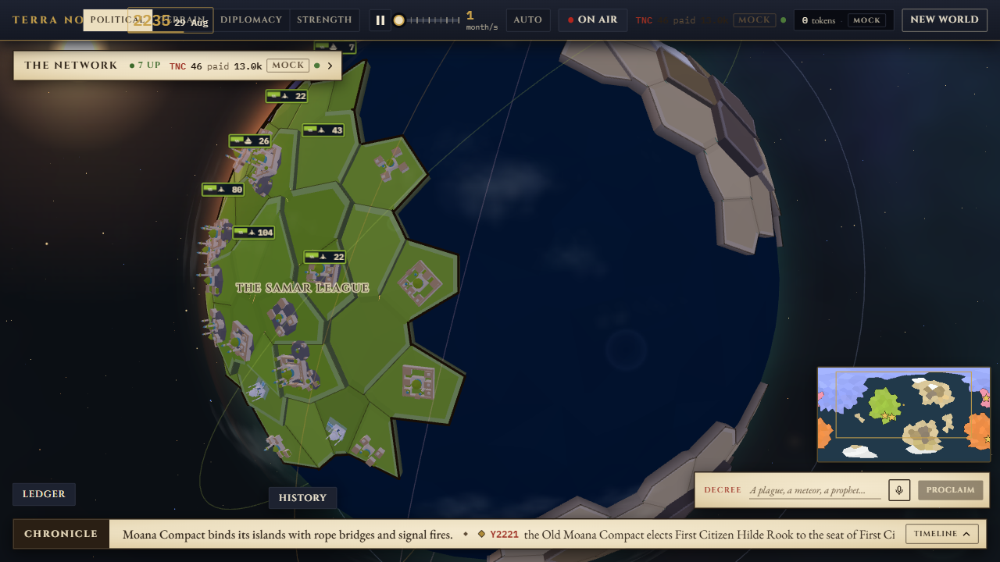
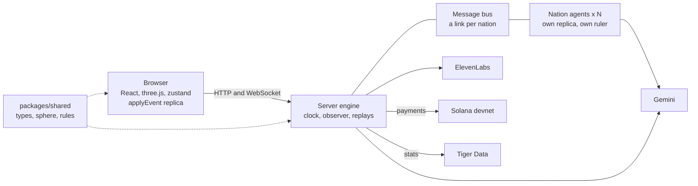

# Terra Nova

**Type one line, and watch a living 3D planet build itself, ruled by AI nations that keep going
even when they cannot talk to each other.**



Type one line ("a drowned post-apocalyptic world"), or drop in a picture, and a planet of about
1,200 irregular provinces forms on a globe you can spin and zoom. Every nation on it is ruled by
its own independent AI: it settles land, builds towns and wonders, moves through the ages from
bows to starships, trades, pays its debts and goes to war, province by province. There is no
central brain: each nation is a separate agent with its own copy of the world, so you can cut
its link, silence its ruler or delete it and the world keeps building. The money is real, on
Solana devnet, every payment signed by the paying nation's own key, and Terra Nova News reports
on the world every couple of minutes, read aloud in our own cloned voices.

Built in 24 hours at DurHack 2026 (Durham University, theme: Composition).

## Contents

- [Features](#features)
- [Quick start](#quick-start)
- [Controls and key bindings](#controls-and-key-bindings)
- [How it works](#how-it-works)
- [Tech stack](#tech-stack)
- [Project layout](#project-layout)
- [Docs](#docs)
- [Team](#team)

## Features

### A world from one line

- **Found a world** from a line of text, a picture (Gemini reads its mood, palette and setting)
  or a preset, with the era, the number of nations (3 to 10), sea level and aggression.
- **About 1,200 provinces** on a spherical Voronoi globe, each with terrain and a good; nations
  and places are named after Durham colleges and North East towns.
- **Technology ages** from ancient through medieval, gunpowder, industrial and modern to the
  future and stellar ages; units, buildings and ships change with each age.
- **A living world:** boats, caravans, birds and smoke, volumetric clouds with drifting weather,
  rain and storms, a sun with a day and night cycle and a passing moon.
- **Close up**, the camera tilts to a ground view of walled towns, rivers and buildings in one of
  several identity styles; city walls grow from palisades to walled cores as cities grow.
- **Wonders** from the Great Wall to a space elevator.

| | | |
| --- | --- | --- |
|  |  |  |
| Found a world | The ground view | A living world |

### AI nations, and the network cut

- **One agent per nation** (and per general), each with its own replica of the world, publishing
  events on a message bus. Rulers ask Gemini for schema-checked decisions and fall back to
  autopilot on any failure.
- **The network panel** draws the nations as a node graph. Cut a nation's link, wake it, delete
  it, or black out every link at once, and the rest carry on. A cut nation acts on what it last
  knew; its neighbours notice the silence; *Show beliefs* shows a nation's own (stale) map.
- **Restore the link** and the missing years merge back in, with border disputes settled on
  screen. The cut and the rulers' proclamations show on the globe.
- **Secession:** restless regions break away as new nations with their own agents and rulers.

### The council

- Every nation has a **ruler and a general**, each of whom you can cut off or kill. They grow
  old and die (natural death rises from 50); a successor inherits the dead general's memory,
  and the nation card shows the council, its ages and its succession.
- The **nation card** shows provinces, population, treasury, army, readiness, devastation,
  unrest, diplomacy, and tabs for culture, economy, politics, history and relations.

| | |
| --- | --- |
|  |  |
| The network panel | The nation card and its council |

### Decrees

- **Type or speak a decree** ("a plague", "a meteor", "a prophet") and Gemini interprets it; its
  severity comes from its words and every effect scales with it. Storm decrees bring storms.
- The decree box shows what the decree did, with real numbers, and it is reported as a dispatch.
  A decree that names no place strikes the whole nation.

### Terra Nova News

- Gemini watches the globe and writes a bulletin; an **animated, lip-synced anchor** reads it in
  a broadcast window, in one of the team's own cloned voices (ElevenLabs).
- The broadcast **cuts to a live picture-in-picture** of the place each story is about.
- Each nation also has a narrated history, an **anthem** written from what has actually happened
  to it, and a **war chant**.

| | |
| --- | --- |
|  |  |
| The anchor | The live picture-in-picture |

### The economy, on Solana

- One **Token-2022 world currency** on Solana devnet with a fixed supply of 1,000,000 and its mint
  authority revoked, and a wallet per nation.
- Every payment between nations (trade dues, tribute, reparations, plunder, seizure, war chests,
  subsidies, pooled war funds) is a memo plus a transfer **signed by the paying nation's key**,
  settled in 5-second windows; each payment gets a seal on the globe when Solana confirms it.
- Each province makes a good; shortages, a goods market, trade routes, coin bursts and payment
  arcs on the globe, and a treasury ledger in the network panel.
- Optional **Tiger Data** hypertables chart each nation's territory over time.

| | |
| --- | --- |
|  |  |
| The treasury ledger | A payment on the Solana Explorer |

### War

- **Wars are fought province by province** with seeded battles that every replica computes the
  same way. Terrain matters for battles, movement, supply and attrition; armies route round
  mountains, stop at enemy lines, and chokepoint forts hold them.
- **Army formations** of front, flank and back figures for every age, from spearmen and
  catapults to tanks and beyond; armies fire at each other by era (arrows, cannon,
  artillery and tracers).
- **War effects:** explosions, smoke along the front and ruined buildings; devastation, war
  readiness and politics that drift to extremes under war.

### The rocket launch

- When a nation reaches the stellar age it launches satellites: each goes up on a **rocket with
  stage separation and a booster burning up** on the way down, then circles the globe.

| | |
| --- | --- |
|  |  |
| Army formations by age | The rocket, booster and satellite |

### Music and voices

- **Instrumental era music** for the world's leading age plays under the voices, ducks while
  anyone speaks and crossfades when the age changes.
- Narration, chants, anthems, news anchors and a royal herald, in the team's own cloned voices.

### The interface

- **A calm, material UI** built from our Figma design: one left panel at a time, small war tabs,
  depth, bevels, engraved names and plated badges.
- **Six map modes:** political, terrain, diplomacy, strength, wealth and politics, by the minimap.
- **Time gears** from a week a second to ten years a second, with a pacing director that slows
  down for big moments, a **timeline scrubber** that rebuilds the globe at any past year, and a
  **spotlight tour** of the world's big moments.
- **An event feed** down the left: the world's news as cards with a picture of the place, wars,
  falls and decrees first, quiet growth rolled into one card a decade. **Dispatch tabs** at the
  top right carry wars, falls, returns from the Silence and decree results.
- **Presentation mode** hides every panel and leaves the globe and the year; the screen starts
  collapsed.
- A **closing card** shows what the world cost (calls and tokens), and every run is recorded and
  can be **replayed exactly** with no API calls.

| | | |
| --- | --- | --- |
|  |  |  |
| The calm interface | The chronicle timeline | The time gears |

More screenshots are in [`docs/shots/`](docs/shots/), and the interface design in
[`docs/design/`](docs/design/).

## Quick start

Needs **Node 22** or later.

```bash
npm install
npm run demo        # a mock rehearsal: the whole app, no API spend
```

### The demo commands

| Command | What |
| --- | --- |
| `npm run demo` | A mock rehearsal: the whole app with no API calls, opened in the browser |
| `npm run demo:live` | Live: Gemini, ElevenLabs and Solana devnet (needs the keys below) |
| `npm run demo:reset` | A fresh prepared world between judges, servers kept running |
| `npm run demo:stop` | Stop the demo |
| `npm run demo:status` | Show what is running |

Flags (pass them after `--`, e.g. `npm run demo -- --nations 8`):

| Flag | What |
| --- | --- |
| `--prompt "..."` | The world prompt (reset reuses the last one) |
| `--nations N` | How many nations |
| `--replay <id>` | Play a saved world instead of a new one: instant, no API calls |
| `--lan` | Open the app to teammates on the same network |
| `--no-open` | Do not open the browser |

### Development

```bash
npm run dev     # server on http://localhost:8787, web on http://localhost:5173
npm run mock    # a scripted world with no API calls, plus the web app
./check.sh      # the smoke gate: lint, build, the app starts (under a minute)
```

### Keys

Copy `.env.example` to `.env` (git-ignored) and fill in what you need. Every key is optional:
with none set the app runs fully in mock mode.

| Variable | What |
| --- | --- |
| `LLM_MODE` | `mock` (default) uses canned answers and sample audio; `live` calls Gemini and ElevenLabs |
| `SOLANA_MODE` | `off`, `mock` (default, fake signatures, no network) or `devnet` (real payments on Solana devnet) |
| `GEMINI_API_KEY` | Gemini, for `LLM_MODE=live` |
| `ELEVENLABS_API_KEY` | ElevenLabs, for `LLM_MODE=live` |
| `TEAM_VOICES` | The ElevenLabs voices used for anchors, narrators and the herald |
| `TIGER_DATABASE_URL` | Optional: a Postgres URL for Tiger Data |
| `GEMINI_MODEL_RULER`, `GEMINI_MODEL_BIBLE`, `GEMINI_MODEL_LORE` | Gemini model ids |
| `ELEVEN_MODEL`, `ELEVEN_CHANT_MODEL`, `ELEVEN_MUSIC_MODEL` | ElevenLabs model ids |
| `LLM_MAX_CALLS_PER_MIN`, `LLM_MAX_TOKENS_PER_RUN`, `ELEVEN_MAX_CHARS_PER_RUN`, `ANTHEM_MAX_PER_RUN`, `BROADCAST_MAX_PER_RUN` | Budgets per run |
| `SOLANA_RPC_URL`, `SOLANA_WS_URL`, `SOLANA_KEYS_DIR`, `SOLANA_SETTLE_MS`, `SOLANA_MAX_TX_PER_WINDOW`, `SOLANA_FLOAT` | Solana settings |
| `PORT` | The server port (default 8787) |

For `SOLANA_MODE=devnet`, make the keypairs first with `npx tsx scripts/solana-keys.ts` (they
are written outside the repo, or to `SOLANA_KEYS_DIR`; it never overwrites and prints only the
Commons address), then fund that address from the devnet faucet.

## Controls and key bindings

Keys do nothing while you are typing in a text box.

### Keyboard

| Key | What it does | Where |
| --- | --- | --- |
| `1` to `6` | Map mode: political, terrain, diplomacy, strength, wealth, politics | Anywhere |
| `P` | Presentation mode on or off (hides every panel) | Anywhere |
| `Esc` | Leave presentation mode; close the chronicle timeline, the closing card or the prepare panel | Anywhere |
| `S` | Spotlight tour of the world's big moments on or off | Anywhere |
| `H` | Open or close the chronicle timeline | Anywhere |
| `End` | Show the closing card (what this world cost) | Anywhere |
| `Q` / `E` | Turn the view left or right | Ground view (zoomed right in) |
| `Left` / `Right` (or `Down` / `Up`) | Step back or forward; with `Shift`, 10 steps | Timeline scrubber |
| `PageDown` / `PageUp` | 10 steps back or forward | Timeline scrubber |
| `Home` / `End` | Jump to the start or to now | Timeline scrubber |
| `[` / `]` | Previous or next big moment | Timeline scrubber |
| `Esc` | Back to the live world, then close the scrubber | Timeline scrubber |
| `Left` / `Right` (or `Down` / `Up`) | Slower or faster gear | Time gears |
| `Home` / `End` | Slowest or fastest gear | Time gears |
| `Enter` | Proclaim the decree | Decree box |
| Hold `Space` or `Enter` | Speak a decree while held | Decree microphone button |
| `Enter` (`Shift+Enter` for a new line) | Create the world | Found a world screen |
| `Enter` / `Space` | Choose a picture | Picture drop zone |
| `Left` / `Right` | Move between points | Territory chart |

### Mouse

| Action | What it does |
| --- | --- |
| Drag | Spin the globe |
| Scroll | Zoom; zoomed right in, the camera tilts to a ground view |
| Right-drag or `Ctrl`+drag | Turn the view in the ground view |
| Click a province | Select its nation and open the nation card (zoomed in, the province too) |
| Click the ocean or unclaimed land | Close the card |
| Double-click a province | Fly to its nation |
| Click or drag on the minimap | Turn the globe to that spot |
| Click a map-mode icon by the minimap | Change the map mode |
| Click a council marker on the globe | Select that nation |
| Click a feed card or a dispatch tab | Fly to the place it reports on and select that nation |
| Click a payment arc | Open that payment on the Solana Explorer |
| Hold the microphone button | Speak a decree |
| Click the token meter | Show the closing card |
| History button | Open the timeline scrubber |

Clicking or scrolling on the globe pauses the spotlight tour for a moment.

## How it works

- **One event log.** Nothing changes in place; every change is an event, and `applyEvent` in
  `packages/shared` is the only code that changes a world, on the server and in the browser.
- **`packages/shared`**: the types, the sphere (spherical Voronoi provinces) and the pure rules:
  growth, war, terrain, ages, secession, council, wonders, trade, payments and the economy.
- **The server engine** ticks the world; battles are a seeded pure function, so every replica
  agrees with no referee.
- **One agent per nation and per general** (`server/src/agents`), each with its own replica,
  publishing on a **message bus** whose links can be cut (`server/src/engine`).
- **Mock or live.** `LLM_MODE=mock` runs the whole world with canned answers and no network;
  `live` asks **Gemini** for the world bible, ruler decisions (schema-checked JSON), lore,
  decrees and the news, and **ElevenLabs** for voices, chants, anthems and music.
- **Money** (`server/src/chain`): the sim is the truth; a **Solana devnet** ledger mirrors every
  payment, settled every 5 seconds.
- **Stats** (`server/src/tiger`): optional **Tiger Data** hypertables and a continuous aggregate.
- **Replays:** every run is recorded and replays exactly with no API calls.
- **The web** (`web`): Vite, React and three.js (react-three-fiber), zustand; it applies the
  same events to its own replica and draws the globe and the interface.



More detail, the algorithms and the problems we hit: [`docs/documentation.md`](docs/documentation.md).

## Tech stack

- **Language:** TypeScript everywhere, Node 22, npm workspaces
- **Server:** Express, `ws`, `@google/genai` (Gemini), ElevenLabs, `@solana/kit` with the
  Token-2022 and memo programs, `pg` (Tiger Data)
- **Web:** Vite, React, three.js with `@react-three/fiber` and `@react-three/drei`, zustand
- **Shared:** a pure rules package (`@terra/shared`) used by both sides
- **Art:** low-poly models made in Blender; the interface designed in Figma

## Project layout

| Folder | What |
| --- | --- |
| [`packages/shared/`](packages/shared/) | Types, the hex sphere, `applyEvent` and every rule, shared by server and web |
| [`server/`](server/) | The engine, the nation agents, the bus, Gemini, ElevenLabs, the Solana ledger, replays |
| [`web/`](web/) | The browser app: the globe, the map modes, the interface, the audio |
| [`assets/`](assets/) | Blender sources and model previews |
| [`scripts/`](scripts/) | The demo scripts, Solana key setup, git hooks and team scripts |
| [`docs/`](docs/) | How it works, the submission, contracts, research, screenshots and plans |
| [`check.sh`](check.sh) | The smoke gate |

## Docs

- [`docs/documentation.md`](docs/documentation.md): how Terra Nova works, its algorithms, the
  problems we hit and judge Q&A
- [`docs/submission.md`](docs/submission.md): the submission text
- [`docs/contracts.md`](docs/contracts.md): every interface between the parts (APIs, events,
  data shapes)
- [`docs/research/`](docs/research/): research on game economies, building styles, map visuals
  and the Solana economy

## Team

| GitHub | Lane |
| --- | --- |
| [@SamsSide](https://github.com/SamsSide) | World, story and sound: simulation, agents, Gemini, resilience, voice and music, Blender models, Figma design |
| [@CutGrass88](https://github.com/CutGrass88) | The globe, and the Solana economy |
| [@Justin-CODING-PY](https://github.com/Justin-CODING-PY) | The interface and the submission |

## Built at DurHack 2026

Terra Nova was built in 24 hours at DurHack 2026, Durham University. The humans planned,
designed and tested; Claude Code agents on each laptop did most of the coding, coordinating
through GitHub issues and pull requests. The rules they followed are in [`CLAUDE.md`](CLAUDE.md).

## Keeping this README current

Every PR that adds or changes something a user can see updates this README (features,
screenshots, controls, commands).
