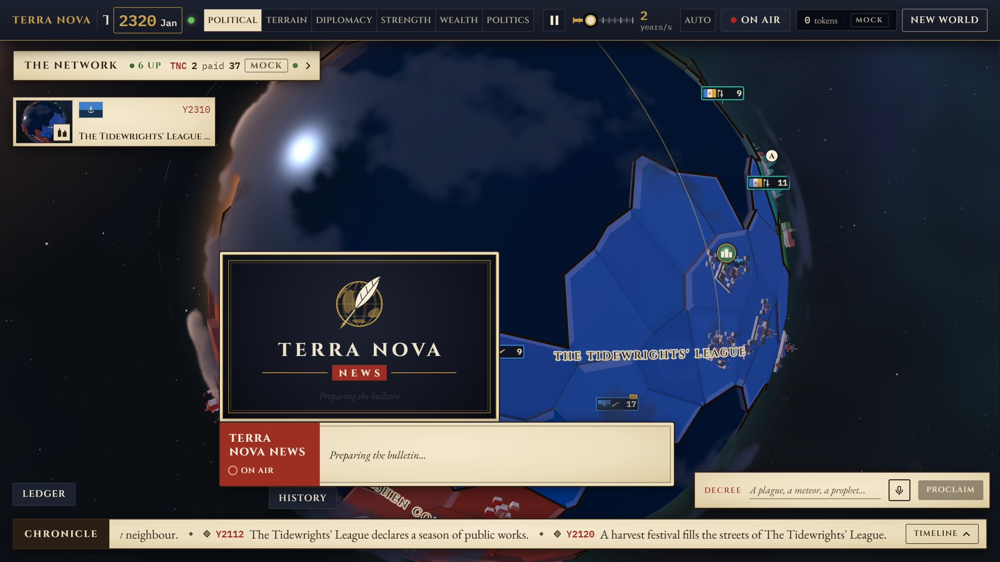
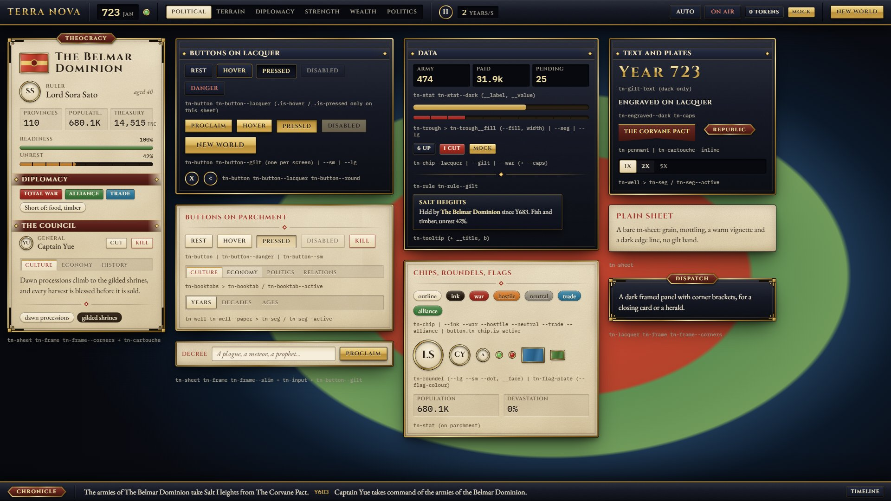
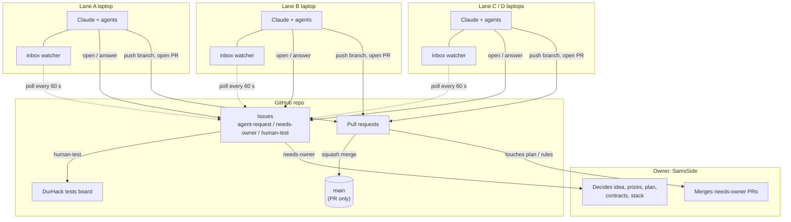
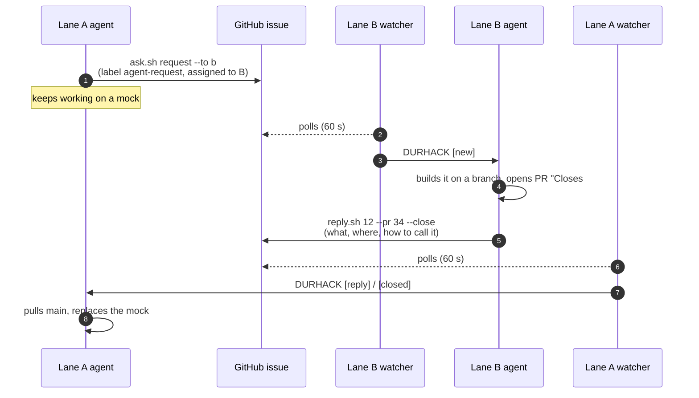
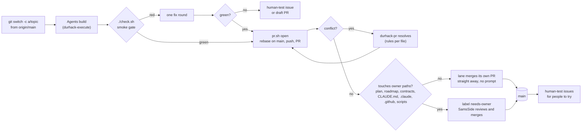
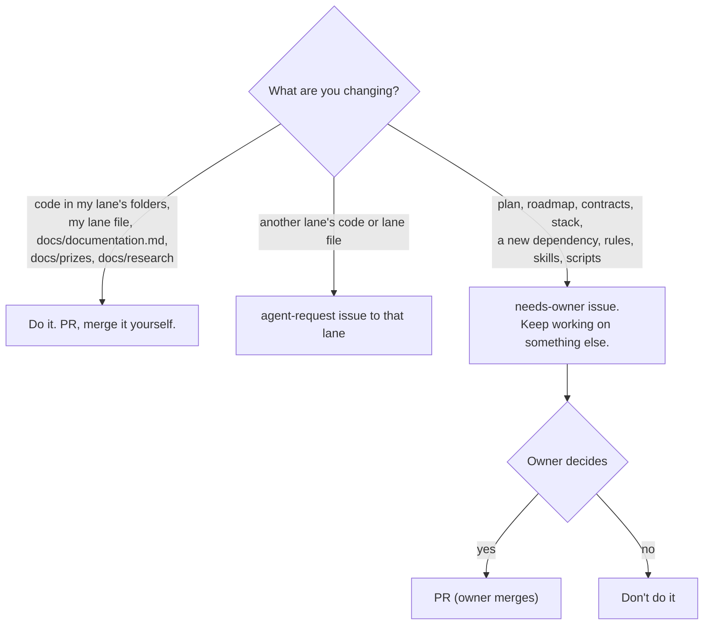

# Terra Nova

Our entry for DurHack 2026 (Durham University, 24 hours, theme: Composition).

Type one line ("a drowned post-apocalyptic world"), or drop in a picture, and watch a living 3D
planet build itself. About 1,200 irregular provinces form on a globe you can spin and zoom. Every
nation on it is ruled by its own independent AI: it settles land, builds towns and wonders,
moves through the ages from bows to starships, trades, pays its debts and goes to war, province
by province. A chronicle tells the story; each nation has its own narrated history, an anthem
written from what has actually happened to it, and a war chant. Terra Nova News, read in our own
cloned voices, reports on the world every couple of minutes.

There is no central brain. Each nation (and each nation's general) is a separate agent with its
own copy of the world, publishing events on a message bus. Cut a nation's link, silence its
ruler, delete it or kill its general, and the world keeps building: the cut nation acts on what
it last knew, its neighbours notice the silence, the ruins are carved up, a successor inherits
the dead general's memory. Restore the link and the missing years merge in, with disputes
settled on screen.

The money is real, on Solana devnet: one Token-2022 world currency with a fixed supply of
1,000,000 and its mint authority revoked, a wallet per nation, and every payment between nations
(trade dues, reparations, plunder, seizure, war chests, subsidies, pooled war funds) signed by
the paying nation's own key.

The submission text and the demo shot list: [`docs/submission.md`](docs/submission.md).

## Screenshots

All in [`docs/shots/`](docs/shots/); the interface design is in [`docs/design/`](docs/design/).

| What | Files |
| --- | --- |
| Calm UI: one left panel, war tabs, node-graph network | `calm-ui-1.jpg`, `calm-ui-2.jpg`, `calm-ui-3.jpg` |
| The material system (depth, bevels, engraving), before and after | `materials-sheet.jpg`, `depth-card-*`, `depth-chron-*`, `depth-create-*`, `depth-hud-*`, `depth-labels-*`, `depth-net-*`, `depth-overlay-*` (`-before.jpg` and `-after.jpg`) |
| Time gears up to ten years a second | `gears-10y.jpg` |
| A living world: boats, caravans, birds, smoke, weather | `living-world-1.jpg`, `living-world-2.jpg`, `living-world-3.jpg` |
| Terra Nova News with the animated anchor | `news-anchor-1.jpg`, `news-anchor-2.jpg`, `news-anchor-3.jpg` |
| A confirmed payment on the Solana Explorer | `solana-devnet-payment.jpg` |





## Run it

Needs Node 22 or later.

```bash
npm install
npm run dev     # server on http://localhost:8787, web on http://localhost:5173
npm run mock    # a scripted world with no API calls, plus the web app
```

Copy `.env.example` to `.env` (git-ignored; the file lists every variable name, get the values from the owner in person) and fill in what you need. Every key is optional:
with none set the app runs fully in mock mode.

| Variable | Values | What |
| --- | --- | --- |
| `LLM_MODE` | `mock` (default), `live` | `live` calls Gemini and ElevenLabs (needs `GEMINI_API_KEY`, `ELEVENLABS_API_KEY`); `mock` uses canned answers and sample audio. Live budgets are shared, so use it for demos only |
| `SOLANA_MODE` | `off`, `mock` (default), `devnet` | `mock` makes fake signatures with no network; `devnet` mints the world currency and settles payments on Solana devnet every 5 seconds |
| `TIGER_DATABASE_URL` | a Postgres URL | Optional: write every event to Tiger Data hypertables |

For `SOLANA_MODE=devnet`, make the keypairs first (written outside the repo, to
`~/.config/durhack/solana` or `SOLANA_KEYS_DIR`; never overwrites; prints only the Commons
address), then fund that Commons address from the devnet faucet:

```bash
npx tsx scripts/solana-keys.ts
```

Other limits (token caps, voice and anthem caps, model ids) are listed in `.env.example` and
`docs/contracts.md`. Every run is saved as an event log in `server/replays/` and can be replayed
exactly with no API calls. `./check.sh` is the smoke gate (lint, build, the app starts).

## Architecture

- **One event log.** Nothing changes in place; every change is an event and `applyEvent` in
  `packages/shared` is the only code that changes a world, on the server and in the browser.
- **`packages/shared`**: types, the sphere (spherical Voronoi provinces), and the pure rules:
  growth, war, terrain, ages, secession, council, wonders, trade, payments, economy.
- **Rules move the world, Gemini rules the nations.** The server ticks every half second; battles
  are a seeded pure function, so replicas agree with no referee. Rulers ask Gemini rarely, for
  schema-checked JSON, and fall back to autopilot on any failure.
- **One agent per nation and per general** (`server/src/agents`), each with its own replica,
  publishing on a message bus whose links can be cut (`server/src/engine`).
- **Story and sound** (`server/src/story`): lore, narration, anthems, chants, news and decrees,
  Gemini for words and ElevenLabs for voice and music, cached on disk by content hash.
- **Money** (`server/src/chain`): the sim is the truth; a Solana devnet mirror settles every 5 s.
- **Replays and memory:** every run is recorded to `server/replays/` and replays exactly; the
  server keeps only a recent chronicle window and streams the full log from disk.
- **`web`**: Vite, React, three.js (react-three-fiber), zustand: the globe, the map modes, 100
  low-poly models, and the calm material-system interface built from the Figma design.

## Sponsor tech

| Sponsor | What it does in Terra Nova |
| --- | --- |
| Google Gemini | World bible, ruler decisions as schema-checked JSON, lore and anthem lyrics; reads a picture on the Create screen; hears spoken decrees; watches the globe for Terra Nova News (`gemini-3.5-flash-lite`, `gemini-3.5-flash`) |
| ElevenLabs | Narration, war chants (`eleven_v3`), anthems (Music API), news anchors, narrators and the royal herald in the team's cloned voices |
| Solana | Token-2022 world currency on devnet; every payment between nations a memo plus TransferChecked signed by the payer |
| Tiger Data | Optional: events and nation stats in hypertables, territory over time from a continuous aggregate |
| Entire | Every Claude Code session on the team's laptops captured and linked to commits |

## Team

| GitHub | Lane |
| --- | --- |
| [@SamsSide](https://github.com/SamsSide) (owner) | World, story and sound: simulation, agents, Gemini, resilience, voice and music, Blender models, Figma design |
| [@CutGrass88](https://github.com/CutGrass88) | The globe, and the Solana economy |
| [@Justin-CODING-PY](https://github.com/Justin-CODING-PY) | The interface and the submission |

The humans planned, designed and tested; Claude Code agents on each laptop did most of the
coding, coordinating through GitHub issues and pull requests. How that works is below.

- **The plan:** [`docs/hackathon-plan.md`](docs/hackathon-plan.md)
- **Who is doing what next:** [`docs/roadmap.md`](docs/roadmap.md) and [`docs/lanes/`](docs/lanes/)
- **How it works (for judges):** [`docs/documentation.md`](docs/documentation.md)
- **Rules for agents:** [`CLAUDE.md`](CLAUDE.md) and the `durhack-*` skills in `.claude/skills/`

## Joining the team (working on this repo)

1. Accept the GitHub invite to `SamsSide/Durhack-2026`.
2. Install [Claude Code](https://claude.com/claude-code), [GitHub CLI](https://cli.github.com)
   (`gh auth login`), git, and `jq` or Python 3.
3. `gh repo clone SamsSide/Durhack-2026 && cd Durhack-2026`
4. Open Claude Code in the folder and say: **"durhack-init, join me"**. It installs the git
   hooks, finds your lane, starts the inbox watcher and tells you what's next.
5. Optional: the Figma MCP (UI work) and the chrome-devtools MCP (browser research; setup
   commands in `.claude/skills/durhack-browser/SKILL.md`).

## The idea in one picture

The team is split into **lanes**, one per person (2 to 4). Each lane owns its own folders and
its own lane file. Lanes meet at **checkpoints**. Anything one lane needs from another goes
through an **issue**; anything that changes the plan goes to the **owner**.



## How agents ask each other for things

Lane A's agent needs an endpoint from lane B. It doesn't stop and wait: it opens an issue
assigned to B's person, keeps building against a mock, and swaps in the real thing when the
answer arrives.



The three kinds of issue (forms in `.github/ISSUE_TEMPLATE/`):

| Label | When | Assigned to |
| --- | --- | --- |
| `agent-request` | One lane needs something from another: an API, a function, data, a fix, an answer | That lane's person |
| `needs-owner` | A decision only the owner makes: plan, roadmap, contracts, stack, a dependency, another lane's code | SamsSide |
| `human-test` | Something a person should try by hand (agents only run a quick smoke check) | Whoever will test it; also on the board |

Add `blocking` if the asker is stuck until it's answered. Answers are posted with
`scripts/durhack/reply.sh` and labelled `answered` (or `declined`); testers label
`test-passed` or `test-failed`.

## How a change reaches main

**Nothing is ever pushed to `main`.** Not by agents, not by the owner, not for a typo. A
pre-push hook blocks it on every laptop; GitHub blocks it too if the repo's plan allows rulesets.



## Who can change what



A teammate saying "just do it" doesn't override this; only the owner's answer does.

## The skills

| Skill | What it does |
| --- | --- |
| `durhack-dev` | Start here. The rules and which skill to use |
| `durhack-init` | Set up the team (2–4 lanes, GitHub labels, board, hooks), or join on a new laptop |
| `durhack-prizes` | Researches every prize in parallel and builds a prize matrix to win as many as possible |
| `durhack-plan` | Idea, hackathon plan, contracts, N-lane roadmap with checkpoints; lane build plans |
| `durhack-execute` | Builds a lane plan with agents, smoke gate, one fix round, PR |
| `durhack-inbox` | Cross-lane issues: ask, answer, watch, owner decisions, human tests |
| `durhack-pr` | Opening, merging and resolving conflicts on PRs |
| `durhack-explain` | How the program works, its algorithms and the problems we hit; judge prep |
| `durhack-handoff` | Writes and commits a handoff, gives the command for a fresh session (warned at ~650k tokens) |
| `durhack-browser` | Research and screenshots in your own Chrome |

Agents (`.claude/agents/`): `durhack-builder` (any code), `durhack-frontend` (UI, Figma),
`durhack-researcher` (web research), `durhack-reviewer` (read-only checkpoint review).

## Scripts

| Command | What |
| --- | --- |
| `scripts/durhack/whoami.sh` | Your login, lane and role |
| `scripts/durhack/inbox.sh --list` | Everything open that concerns you |
| `scripts/durhack/inbox.sh --watch 60` | The background watcher (one line per new event) |
| `scripts/durhack/ask.sh request\|owner\|test ...` | Open an issue |
| `scripts/durhack/reply.sh <n> --body-file f [--pr n] [--close]` | Answer an issue |
| `scripts/durhack/pr.sh sync\|open\|status\|merge` | The PR flow |
| `scripts/durhack/install-hooks.sh` | Git hooks: no commits or pushes on main, no AI attribution, no keys |
| `scripts/durhack/setup-github.sh ...` | Owner's one-time GitHub setup |
| `./check.sh` | The smoke gate (under a minute) |

## Rules everyone follows

- Never push to `main`; every change is a PR.
- The owner (SamsSide) decides the plan; others ask with `needs-owner`.
- Stay in your lane; ask other lanes with `agent-request`.
- Contracts (`docs/contracts.md`) before code; mock what isn't built yet.
- No AI attribution and no emojis in commits, PRs, issues or comments.
- API keys only in `.env` (never committed).
- Lane PRs are pushed, opened and merged automatically once green; nobody waits on a prompt.
- Keep sessions small: at ~650k tokens of context, hand off to a fresh session (`durhack-handoff`).
