# Terra Nova

**Type one line, and watch a living 3D planet build itself, ruled by AI nations that keep going
even when they cannot talk to each other.**


Type one line ("a drowned post-apocalyptic world"), or drop in a picture, and a planet of about
1,200 irregular provinces forms on a globe you can spin and zoom. Every nation on it is ruled by
its own independent AI: it settles land, builds towns and wonders, moves through the ages from
bows to starships, trades, pays its debts and goes to war, province by province. There is no
central brain: each nation is a separate agent with its own copy of the world, so you can cut
its link, silence its ruler or delete it and the world keeps building. The money is real, on
Solana devnet, every payment signed by the paying nation's own key, and Terra Nova News reports
on the world every couple of minutes, read aloud in our own cloned voices.

Built in 24 hours at DurHack 2026 (Durham University, theme: Composition).

## Contents

- [Features](#features)
- [Quick start](#quick-start)
- [Controls and key bindings](#controls-and-key-bindings)
- [How it works](#how-it-works)
- [Tech stack](#tech-stack)
- [Project layout](#project-layout)
- [Docs](#docs)
- [Team](#team)

## Features

### A world from one line

- **Found a world** from a line of text, a picture (Gemini reads its mood, palette and setting)
  or a preset, with the era, the number of nations (3 to 10), sea level and aggression.
- **About 1,200 provinces** on a spherical Voronoi globe, each with terrain and a good; nations
  and places are named after Durham colleges and North East towns.
- **Technology ages** from ancient through medieval, gunpowder, industrial and modern to the
  future and stellar ages; units, buildings and ships change with each age. A nation cannot enter
  an age before its calendar year (medieval 500, gunpowder 1400, industrial 1760, modern 1900,
  future 2050, stellar 2150); a world's starting era wins.
- **A living world:** boats, caravans, birds and smoke, volumetric clouds with drifting weather,
  rain and storms, a sun with a day and night cycle and a passing moon. The lens flare only
  shows while the sun is in view or peeking past the planet's edge.
- **Close up**, the camera tilts to a ground view of walled towns, rivers and buildings in one of
  several identity styles; city walls grow from palisades to walled cores as cities grow.
- **Towns modernise through the ages:** a nation keeps its own building style up to the
  gunpowder age, moves to concrete blocks (eastern or authoritarian nations) or glass towers
  (everyone else) at the industrial age, and builds shielded arcologies in the future and stellar
  ages. Industrial and modern towns pull down their old stone walls for a ring road. Each age step
  sweeps out from the capital, town by town, over about three seconds.
- **Ports and docks:** every port reaches a pier into the sea toward the nearest open water, with moored boats and a
  look that follows its nation's age: wooden jetties and a lighthouse, stone quays and cranes, container wharves
  with gantry cranes and stacked containers, then floating docks. Coastal towns get a smaller pier of the same age.
- **Wonders** from the Great Wall to a space elevator.

| | | |
| --- | --- | --- |
| 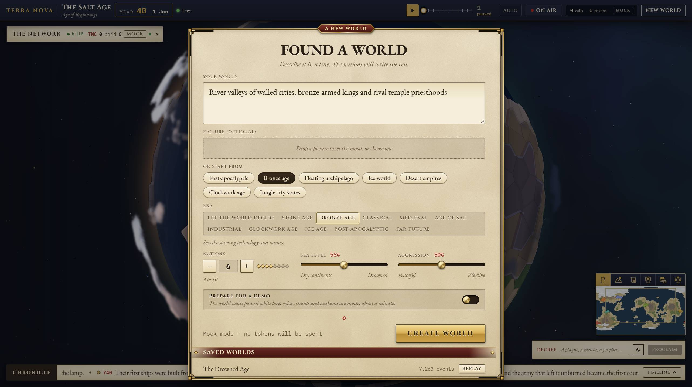 |  | 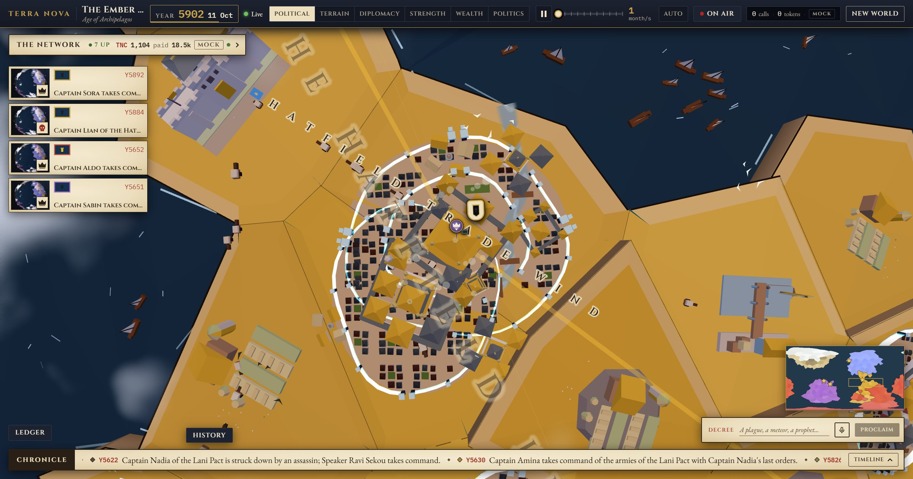 |
| Found a world | The ground view | A living world |

| | | |
| --- | --- | --- |
| 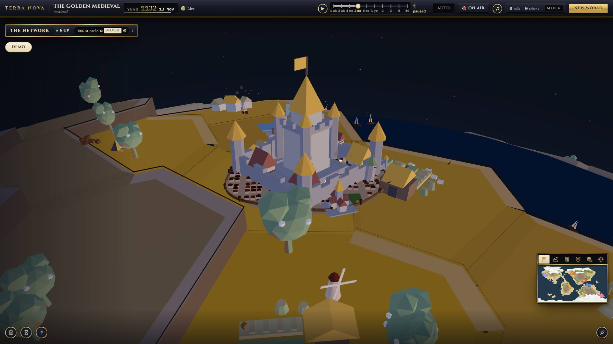 | 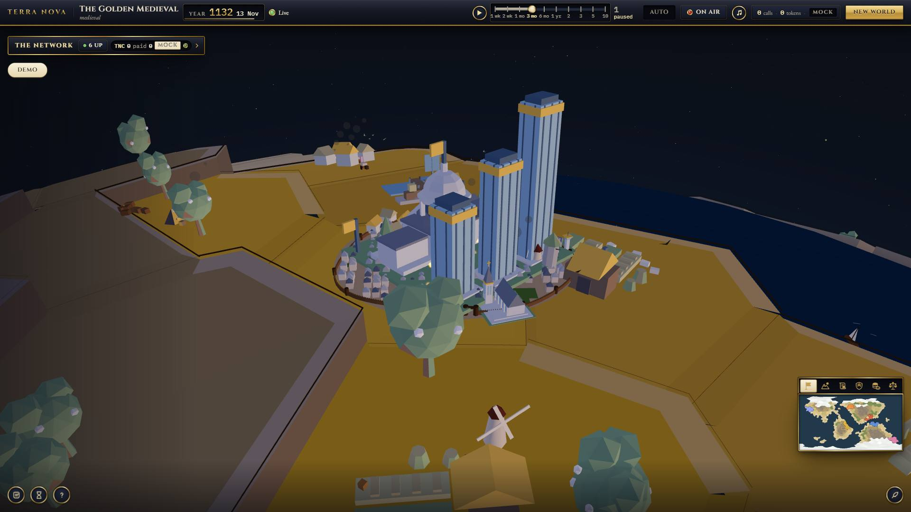 | 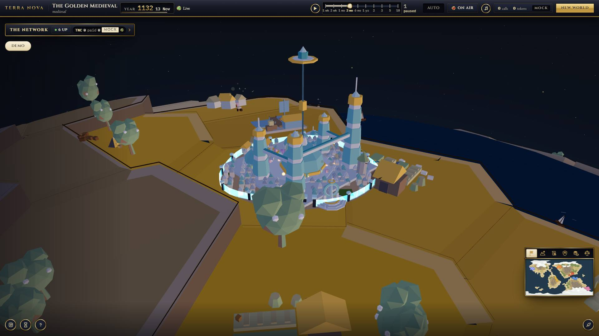 |
| One capital, medieval | Industrial | Future |

### AI nations, and the network cut

- **One agent per nation** (and per general), each with its own replica of the world, publishing
  events on a message bus. Rulers ask Gemini for schema-checked decisions and fall back to
  autopilot on any failure.
- **The network panel** draws the nations as a node graph. Cut a nation's link, wake it, delete
  it, or black out every link at once, and the rest carry on. A cut nation acts on what it last
  knew; its neighbours notice the silence; *Show beliefs* shows a nation's own (stale) map.
- **Restore the link** and the missing years merge back in, with border disputes settled on
  screen. The cut and the rulers' proclamations show on the globe.
- **A cut nation is visible:** it greys under mist, with a small pile of sealed letters and the
  tag "SIGNAL LOST · silent N yrs · M queued". On restore the letters fly to the other capitals.
- **Ruler proclamation scrolls** are each tagged AI or AUTOPILOT.
- **Secession:** restless regions break away as new nations with their own agents and rulers.
- **A national mood that shifts:** each nation's temperament (aggression, expansion, trade, faith)
  drifts a little every year with what happens to it. A long war or bitter losses harden it,
  defeat and exhaustion take the fight out of it, victories make it hungry for land, long peace and
  trade pacts make merchants of it, and unrest, plague and prophets turn it to its temples; with
  nothing pushing, it slowly returns to its founding character. The chronicle says when a mood
  turns ("Years of war have hardened the Dorrin Horde."), the nation card shows its current mood,
  and its ruler decides with it.

### The council

- Every nation has a **ruler and a general**, each of whom you can cut off or kill. They grow
  old and die (natural death rises from 50); a successor inherits the dead general's memory,
  and the nation card shows the council, its ages and its succession.
- Markers over one capital (council pips, the newest of mourning, succession or coup, the battle
  plate, a ruler's proclamation and a decree caption) stack in a neat column and never overlap.
- The **nation card** shows provinces, population, treasury, army, readiness, devastation,
  unrest, diplomacy, and tabs for culture, economy, politics, history and relations.

| | |
| --- | --- |
| 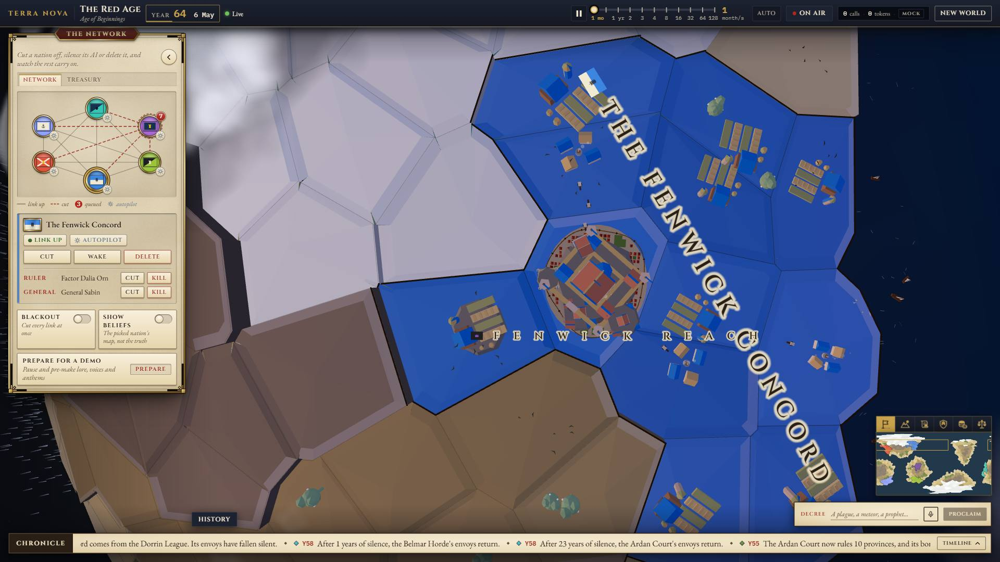 | 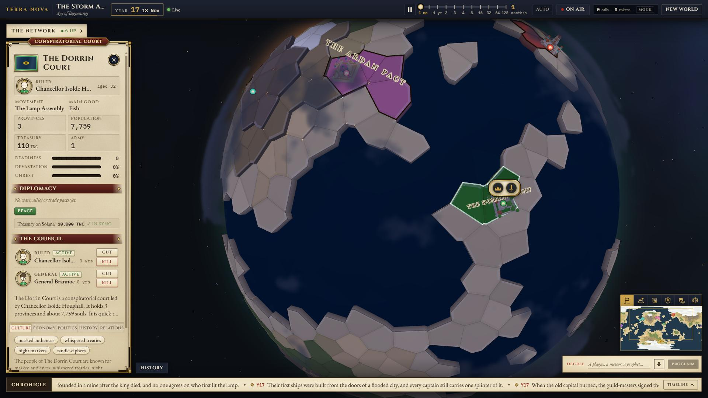 |
| The network panel | The nation card and its council |

### Decrees

- **Type or speak a decree** ("a plague", "a meteor", "a prophet") and Gemini interprets it; its
  severity comes from its words and every effect scales with it. Storm decrees bring storms.
- The decree box shows what the decree did, with real numbers, and it is reported as a dispatch.
  A decree that names no place strikes the whole nation.
- **Decree visuals:** the camera flies to the target, then the effect plays out: meteor, plague,
  famine, storm, flood, prophet, gold rush or rebellion, with a result caption.

### Terra Nova News

- Gemini watches the globe and writes a bulletin; an **animated, lip-synced anchor** reads it in
  a broadcast window, in one of the team's own cloned voices (ElevenLabs).
- The broadcast **cuts to a live picture-in-picture** of the place each story is about. A story
  about a war cuts to the battle with a **war report** over it: both flags, the two armies and
  each side's losses.
- Each nation also has a narrated history, an **anthem** written from what has actually happened
  to it, and a **war chant**.

| | |
| --- | --- |
| 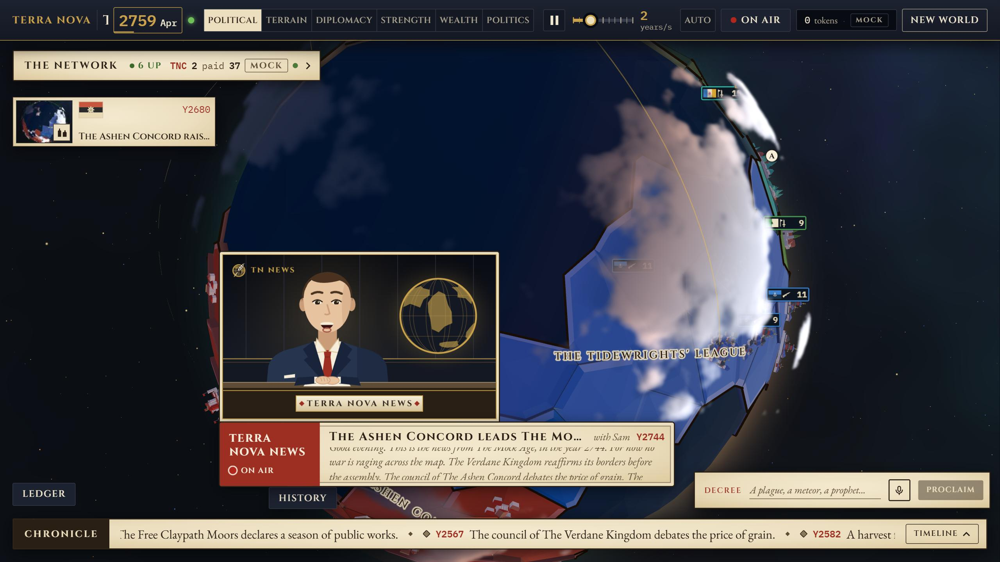 | 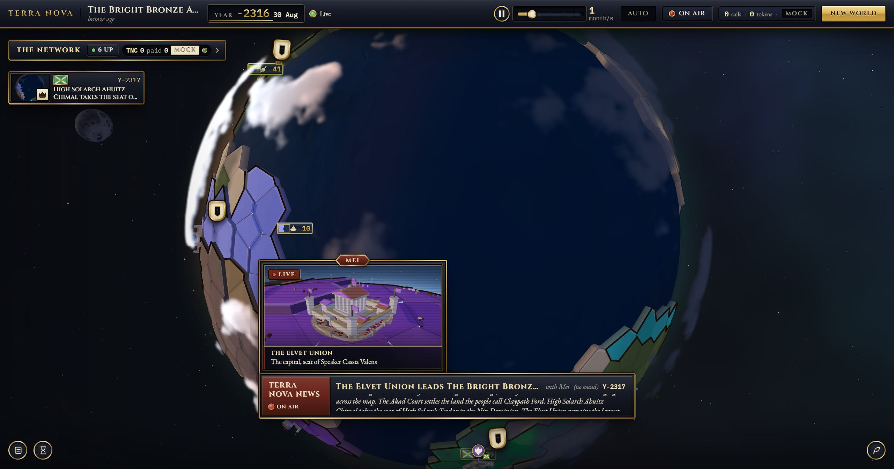 |
| The anchor | The live picture-in-picture |

### The economy, on Solana

- One **Token-2022 world currency** on Solana devnet with a fixed supply of 1,000,000 and its mint
  authority revoked, and a wallet per nation.
- Every payment between nations (trade dues, tribute, reparations, plunder, seizure, war chests,
  subsidies, pooled war funds) is a memo plus a transfer **signed by the paying nation's key**,
  settled in 5-second windows. When Solana confirms a payment, a **red wax seal** stamps on its arc
  on the globe; click it to open Solana Explorer.
- Each province makes a good; shortages, a goods market, trade routes, coin bursts and payment
  arcs on the globe, and a treasury ledger in the network panel.
- Optional **Tiger Data** hypertables chart each nation's territory over time.

| | |
| --- | --- |
|  | 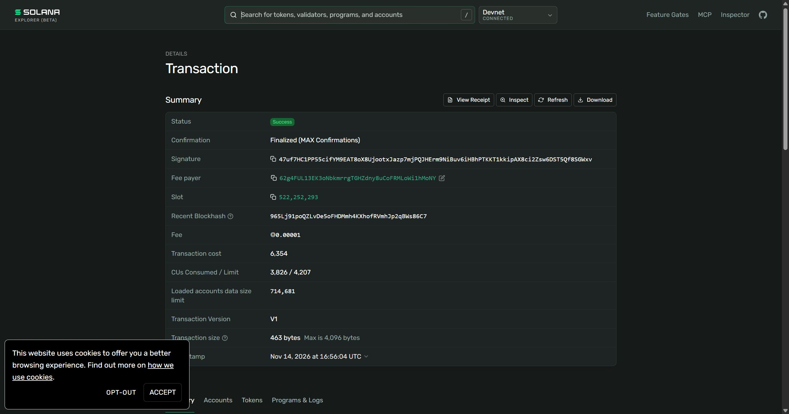 |
| The treasury ledger | A payment on the Solana Explorer |

### War

- **Every world has a warmonger:** one ruler, the nation nearest a rival, is always hot-blooded
  (at least the Create screen's Aggression), and while the world is at peace it may start the
  first war from year 20 instead of year 70, so a war is on show within the first minute or two.
- **Wars are fought province by province** with seeded battles that every replica computes the
  same way. Terrain matters for battles, movement, supply and attrition; armies route round
  mountains, stop at enemy lines, and chokepoint forts hold them.
- **Army formations** of front, flank and back figures for every age, from spearmen and
  catapults to tanks and beyond; armies fire at each other by era: arrows, crossbows and
  trebuchets, cannon, artillery, tank tracers, drones and orbital strike.
  Troops move like troops: foot soldiers step and sway, horses canter, guns recoil, mechs stomp, ships roll on the swell, and the fallen drop one by one.
- **Battles read at a glance:** every army at war carries a short status line above its counter
  ("Advancing on", "Assaulting", "Besieging", "Holding the line", "Retreating", "Routed"), fading
  out as the camera pulls back. Volleys flash and smoke along the line, with the odd shell
  exploding among the enemy from the industrial age, and a bold red attack arrow runs from
  attacker to defender for as long as the battle rages.

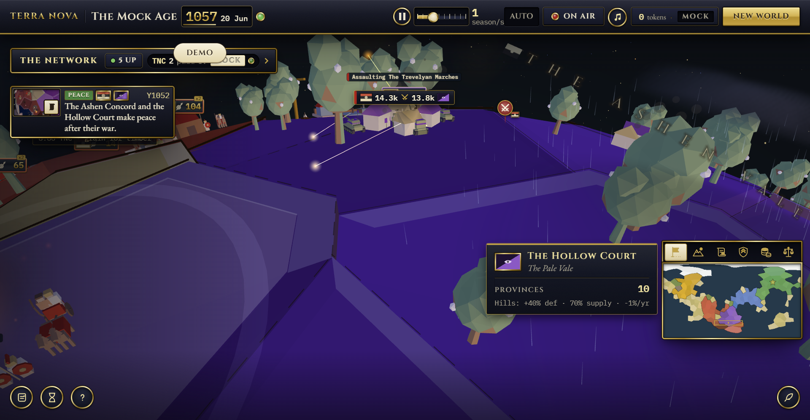

- **Select an army or a battle:** click an army chip or its figures for its troops, general and
  status; click a battle badge for both sides, losses and the battle-line grid.
- **War effects:** explosions by era, smoke over the front, and cities turning to ruins and rebuilding; devastation, war
  readiness and politics that drift to extremes under war.
- **Naval battles you can see:** fleets at war hunt each other across the sea and trade broadsides by age:
  arrows (ancient), fire pots (medieval), cannon with smoke puffs (gunpowder), gun flashes and shell
  splashes (industrial and modern), beams (future and later). Missed shots splash in the sea, hits
  flash on the hull, a beaten ship rolls over and sinks in a ring of foam, and a raiding fleet shells the coast.
  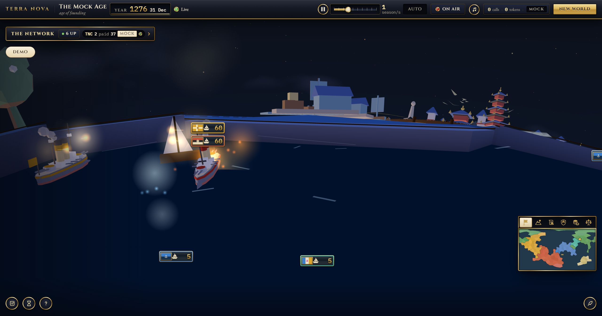
- **Army and battle cards:** click an army's counter to see its flag, status (marching,
  fighting or garrisoned), general, soldiers, war readiness and its front, flank and back troops
  by age. Click a battle's badge to see "Battle of" the province, how long it has raged, both
  sides' generals, strength at the start and now, losses, and a battle grid whose front line
  thins and flanks fold in as the losses mount. To preview them without a war, add `?mockArmy=1`
  or `?mockBattle=1` to the URL.
- **Satellites shot down:** in an all-out war between two nations of the modern age or later, now
  and then one side knocks out a rival's satellite. A strike streaks up from its capital, a flash
  and a burst of debris mark the hit, and the wreck tumbles off its ring; the chronicle tells it
  ("A missile from the Tidemark Kingdom knocks a satellite of the Framwell Court out of the sky").
  Rare: under one chance in a hundred a year, at most once in 80 years per nation. The nation
  launches a replacement on its usual rhythm.

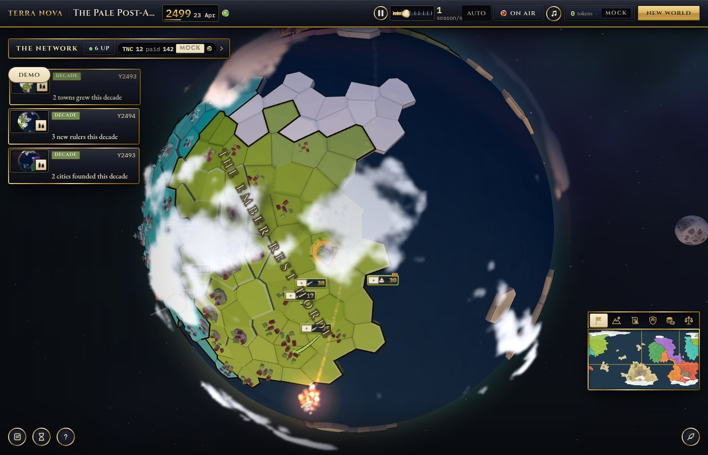

| | |
| --- | --- |
| 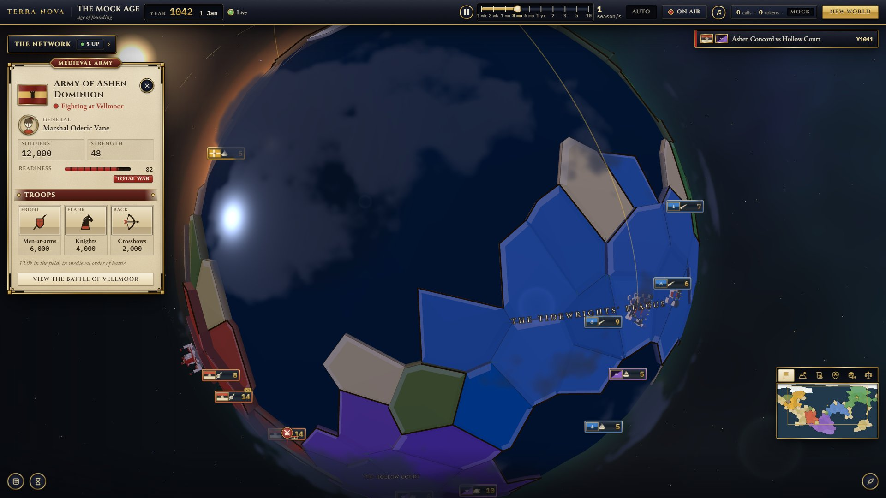 | 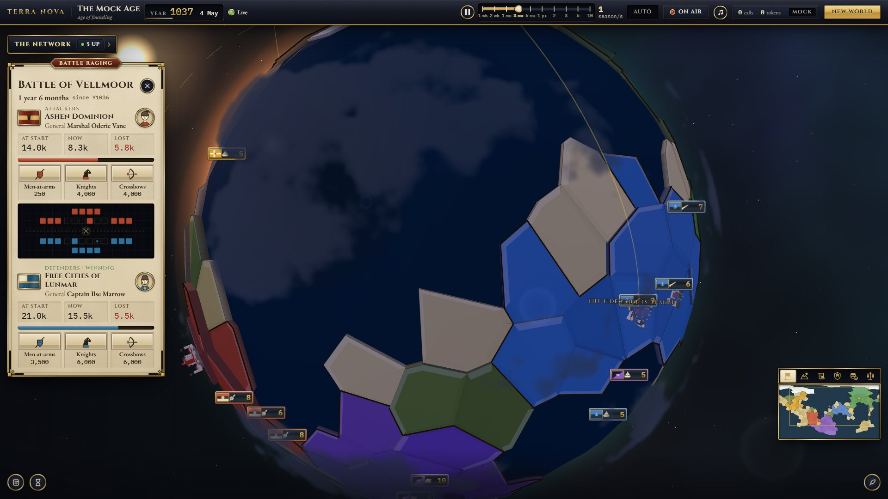 |
| The army card | The battle card |

### The rocket launch

- Satellites come with the modern age, from 1957 on: a modern nation launches one, a future-age
  nation keeps two up and a stellar nation four. Each goes up on a **rocket with stage
  separation, a satellite release and a booster burning up** on re-entry, then the satellite
  circles the globe.

| | |
| --- | --- |
|  | 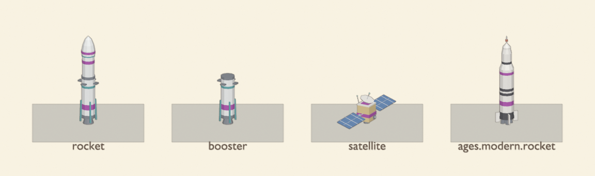 |
| Army formations by age | The rocket, booster and satellite |

| | | |
| --- | --- | --- |
| 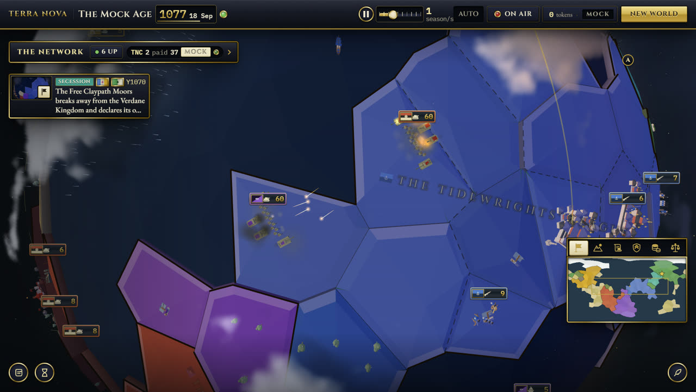 | 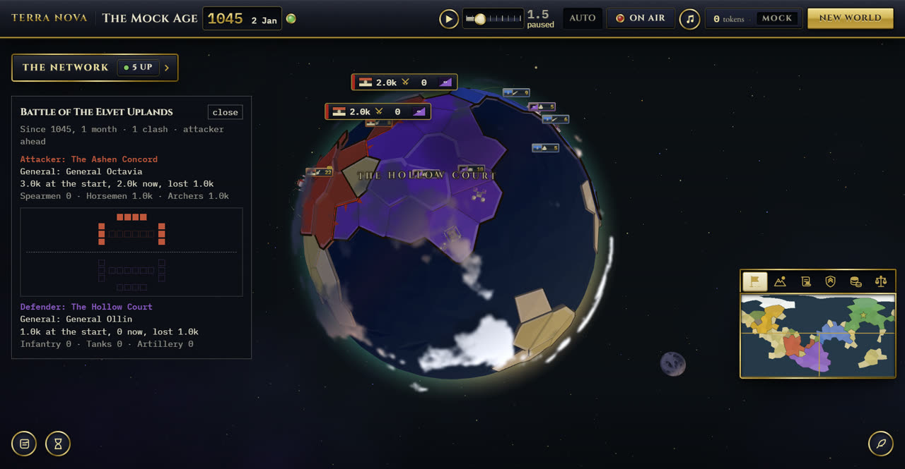 | 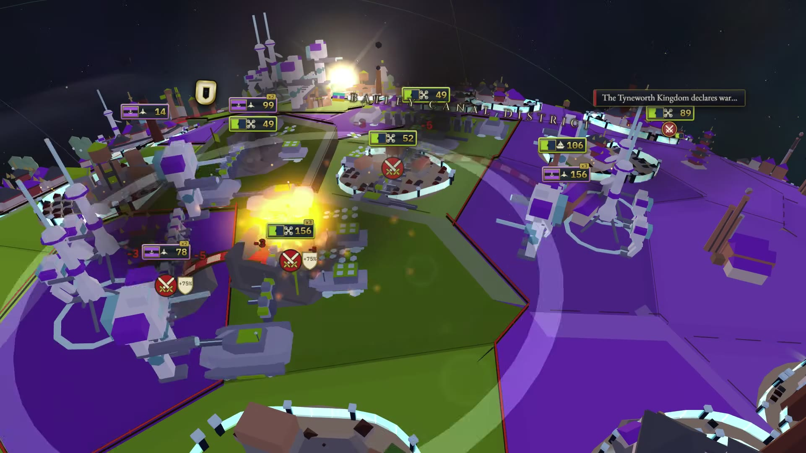 |
| Firing by era | A selected battle | War at the front |
| 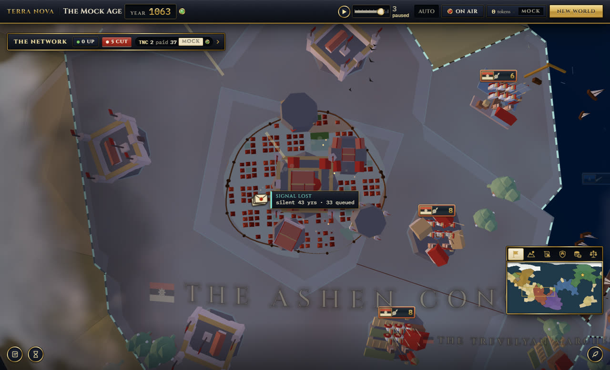 | 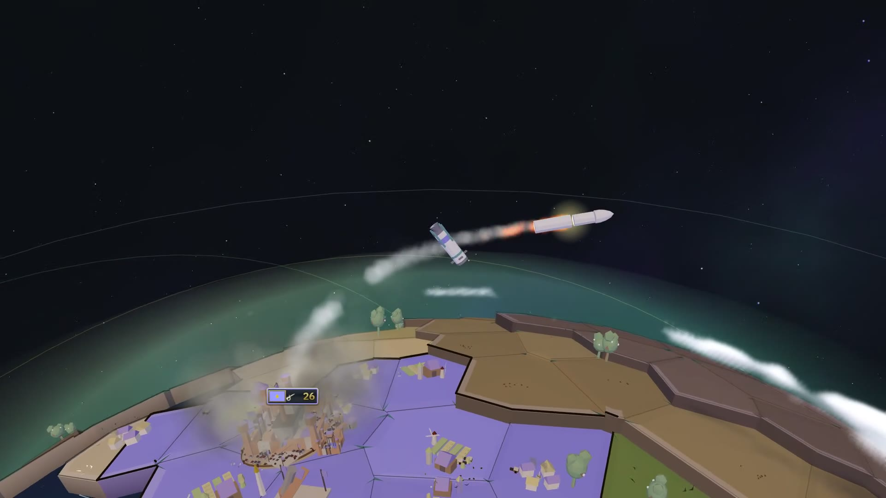 | 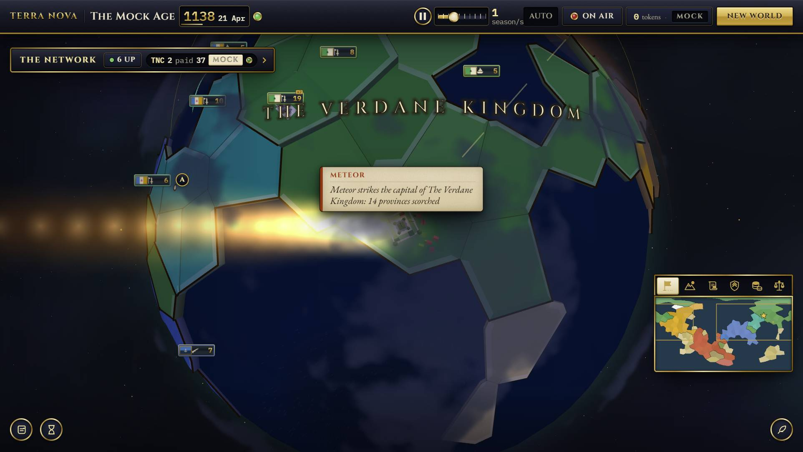 |
| A cut nation | Stage separation | A meteor decree |

### Music and voices

- **Instrumental era music** for the world's leading age plays under the voices, ducks while
  anyone speaks and crossfades when the age changes.
- Narration, chants, anthems, news anchors and a royal herald, in the team's own cloned voices.

### The interface

- **A calm, material UI** built from our Figma design: one left panel at a time, small war tabs,
  depth, bevels, engraved names and plated badges.
- **Six map modes:** political, terrain, diplomacy, strength, wealth and politics, by the minimap.
- **Time gears** from a week a second to ten years a second, with a pacing director that slows
  down for big moments, a **timeline scrubber** that rebuilds the globe at any past year, and a
  **spotlight tour** of the world's big moments.
- **An event feed** down the left: the world's news as cards with a picture of the place, wars,
  falls and decrees first, quiet growth rolled into one card a decade. **Dispatch tabs** at the
  top right carry wars, falls, returns from the Silence and decree results.
- **A help screen** (the `?` button or `?` / `F1`) labels every control and icon for a newcomer;
  it starts closed.
- **Presentation mode** hides every panel and leaves the globe and the year; the screen starts
  collapsed.
- A **closing card** shows what the world cost (calls and tokens), and every run is recorded and
  can be **replayed exactly** with no API calls.

| | | |
| --- | --- | --- |
| 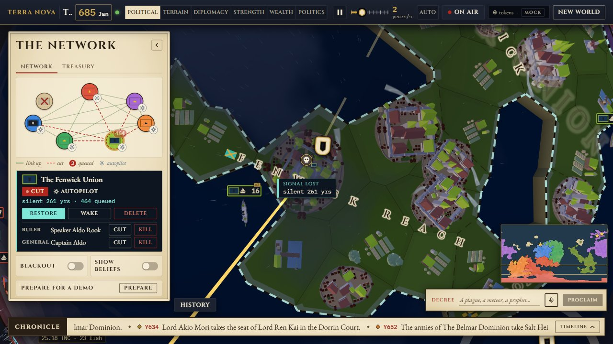 |  |  |
| The calm interface | The chronicle timeline | The time gears |

More screenshots are in [`docs/shots/`](docs/shots/), and the interface design in
[`docs/design/`](docs/design/).

## Quick start

Needs **Node 22** or later.

```bash
npm install
npm run demo        # opens the Terra Nova desktop app (Windows, from WSL): settings, checks, Start
```

### The desktop app

On Windows with WSL, `npm run demo` opens **Terra Nova** as its own desktop app. The first run
builds it on Windows (`C:\terra-desktop`, about a minute) and puts a **Terra Nova** shortcut on the
desktop; later runs rebuild only when `desktop/` changed. The server and the web still run in WSL
through `scripts/demo.sh`; the app is the window around them and holds no keys.

1. **Setup.** Pick the settings below (saved for next time), press **Run checks**: each check
   appears as it finishes (PASS, WARN, FAIL, SKIP), including which GPU the game will render on
   (it must be the NVIDIA one).
2. **Start** is enabled when nothing failed (**Start anyway** beside it skips that). A splash shows
   the progress (**Logs** streams the server log), then the game opens fullscreen on the external
   1920x1080 display if one is connected.
3. Between judges press `Ctrl+Shift+R`; `Ctrl+Shift+S` goes back to setup. Quitting the app stops
   the demo.

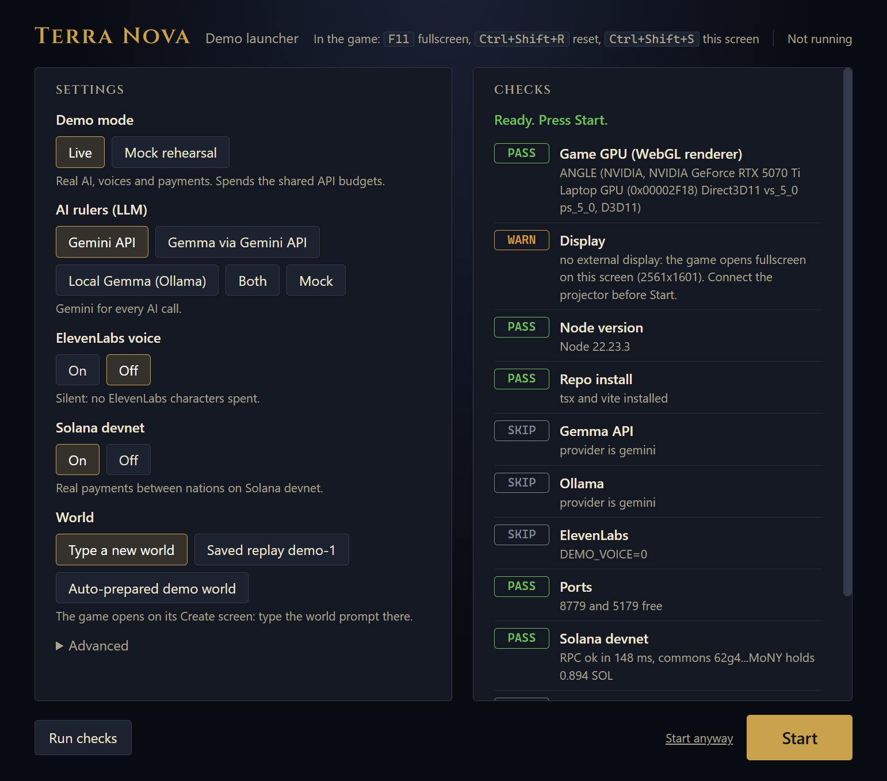

| Setting | Choices |
| --- | --- |
| Demo mode | **Live** (`demo.sh live`) or **Mock rehearsal** (`demo.sh mock`, no API calls) |
| AI rulers (LLM) | **Gemini API**, **Gemma via Gemini API**, **Local Gemma (Ollama)**, **Both** (local Gemma for ruler turns, Gemini for the rest) or **Mock** (`LLM_PROVIDER`, `LLM_MODE`); the Advanced fold sets the models, the Ollama host and the ports |
| ElevenLabs voice | **On** or **Off** (`--no-voice`: no ElevenLabs calls) |
| Solana devnet | **On** (`SOLANA_MODE=devnet`) or **Off** (mock ledger) |
| World | **Type a new world** (the game opens on its Create screen), **Saved replay demo-1** (instant) or **Auto-prepared demo world** |

If the app misbehaves at the table, `desktop/fallback/terra-chrome.bat` starts the same demo and
opens it in a fullscreen Chrome app window; `npm run demo:terminal` is the old terminal flow.

### Preflight

Before the live demo, `npm run demo:check` (the desktop launcher runs it too) tests every enabled
service and prints one PASS, WARN, FAIL or SKIP line each: Node 22, the install, free ports,
Gemini (and Gemma or Ollama when `LLM_PROVIDER` picks them), ElevenLabs characters left, and the
Solana devnet RPC and commons balance. It ends with `READY` or `NOT READY: N failed`; add
`--json` for one JSON object per line. Under `LLM_MODE=mock` every paid check is skipped.

### The demo commands

| Command | What |
| --- | --- |
| `npm run demo` | Open the desktop app (Windows from WSL): settings, checks, then the game; elsewhere it runs `demo:terminal` |
| `npm run demo:terminal` | The live demo from the terminal: Gemini, ElevenLabs and Solana devnet (needs the keys below), opened in the browser |
| `npm run demo:mock` | A mock rehearsal: the whole app with no API calls |
| `npm run demo:check` | The preflight checks, with the keys loaded as the demo loads them (`-- --mock` for a rehearsal) |
| `npm run desktop:build` | Build the desktop app again by hand (copies `desktop/` to `C:\terra-desktop`) |
| `npm run demo:reset` | A fresh prepared world between judges, servers kept running |
| `npm run demo:stop` | Stop the demo |
| `npm run demo:status` | Show what is running |

Flags (pass them after `--`, e.g. `npm run demo:terminal -- --nations 8`):

| Flag | What |
| --- | --- |
| `--prompt "..."` | The world prompt (reset reuses the last one) |
| `--nations N` | How many nations |
| `--replay <id>` | Play a saved world instead of a new one: instant, no API calls |
| `--no-world` | Start with no world: the app opens on its Create screen |
| `--no-voice` | No ElevenLabs: the key is dropped after the keys files load |
| `--lan` | Open the app to teammates on the same network |
| `--no-open` | Do not open the browser |

### Development

```bash
npm run dev     # server on http://localhost:8787, web on http://localhost:5173
npm run mock    # a scripted world with no API calls, plus the web app
./check.sh      # the smoke gate: lint, build, the app starts (under a minute)
```

### Demo panel and dev helpers (dev builds)

Press backquote or `Shift+D`, or open the app with `?demo`: a draggable, resizable, collapsible
pill. Buttons: Launch rocket, War demo, Seal on chain, Economy demo, Council, Wonder, Shooting
star; speed presets; Hide HUD and Show HUD for clean screenshots.

Dev helpers, run in the browser console:

- `__launchDemo()`: launch a satellite rocket
- `__shootDown(victim?, attacker?, slow?)`: shoot down a satellite (one is put up first if needed; `slow` 0..1 for slow motion)
- `__warDemo()`: a scripted battle
- `__firingDemo(age)`: armies firing the weapons of one age
- `__decreeDemo(effect)`: play one decree effect
- `__sealDemo()`: stamp the on-chain seal on a payment
- `__econDemo()`: the economy demo
- `__townAge(countryId, age)`: set a nation's tech age locally and watch its towns modernise

### Keys

Copy `.env.example` to `.env` (git-ignored) and fill in what you need. Every key is optional:
with none set the app runs fully in mock mode.

| Variable | What |
| --- | --- |
| `LLM_MODE` | `mock` (default) uses canned answers and sample audio; `live` calls Gemini and ElevenLabs |
| `SOLANA_MODE` | `off`, `mock` (default, fake signatures, no network) or `devnet` (real payments on Solana devnet) |
| `GEMINI_API_KEY` | Gemini, for `LLM_MODE=live` |
| `ELEVENLABS_API_KEY` | ElevenLabs, for `LLM_MODE=live` |
| `TEAM_VOICES` | The ElevenLabs voices used for anchors, narrators and the herald |
| `TIGER_DATABASE_URL` | Optional: a Postgres URL for Tiger Data |
| `GEMINI_MODEL_RULER`, `GEMINI_MODEL_BIBLE`, `GEMINI_MODEL_LORE` | Gemini model ids |
| `ELEVEN_MODEL`, `ELEVEN_CHANT_MODEL`, `ELEVEN_MUSIC_MODEL` | ElevenLabs model ids |
| `LLM_MAX_CALLS_PER_MIN`, `LLM_MAX_TOKENS_PER_RUN`, `ELEVEN_MAX_CHARS_PER_RUN`, `ANTHEM_MAX_PER_RUN`, `BROADCAST_MAX_PER_RUN` | Budgets per run |
| `SOLANA_RPC_URL`, `SOLANA_WS_URL`, `SOLANA_KEYS_DIR`, `SOLANA_SETTLE_MS`, `SOLANA_MAX_TX_PER_WINDOW`, `SOLANA_FLOAT` | Solana settings |
| `PORT` | The server port (default 8787) |

Which model answers is a switch (`LLM_MODE=live` only; mock never calls anything). Voice decrees
(audio in) and painted flags always stay on Gemini.

| Variable | What |
| --- | --- |
| `LLM_PROVIDER` | `gemini` (default), `gemma-api` (Gemma through the Gemini API), `ollama` (local Gemma) or `hybrid` |
| `GEMMA_API_MODEL` | The Gemma id for `gemma-api` (default `gemma-4-26b-a4b-it`) |
| `OLLAMA_HOST`, `OLLAMA_MODEL` | Where Ollama listens (default `http://localhost:11434`) and its model (default `gemma4:e4b-it-qat`; run `ollama pull gemma4:e4b-it-qat` once) |
| `OLLAMA_TIMEOUT_MS`, `OLLAMA_BIBLE_TIMEOUT_MS` | How long a local answer may take (default 20000) and how long the world bible may take (default 75000) before the template is used |
| `LLM_LOCAL_PURPOSES` | In `hybrid`, the purposes sent to Ollama (default `ruler`); the rest stay on Gemini |

Check a setup with `LLM_PROVIDER=hybrid npx tsx server/scripts/check-llm.ts` (one tiny call per route,
prints `PASS` or `FAIL`).

For `SOLANA_MODE=devnet`, make the keypairs first with `npx tsx scripts/solana-keys.ts` (they
are written outside the repo, or to `SOLANA_KEYS_DIR`; it never overwrites and prints only the
Commons address), then fund that address from the devnet faucet.

## Controls and key bindings

Keys do nothing while you are typing in a text box.

### Keyboard

| Key | What it does | Where |
| --- | --- | --- |
| `1` to `6` | Map mode: political, terrain, diplomacy, strength, wealth, politics | Anywhere |
| `P` | Presentation mode on or off (hides every panel) | Anywhere |
| `` ` `` (backquote) or `Shift+D` | Show or hide the demo panel (dev builds; or open with `?demo`) | Anywhere |
| `?` / `F1` | Open or close the help screen | Anywhere |
| `Esc` | Clear the army or battle selection; leave presentation mode; close the help screen, the chronicle timeline, the closing card or the prepare panel | Anywhere |
| `S` | Spotlight tour of the world's big moments on or off | Anywhere |
| `H` | Open or close the chronicle timeline | Anywhere |
| `End` | Show the closing card (what this world cost) | Anywhere |
| `F11` | Fullscreen on or off | The desktop app |
| `Ctrl+Shift+R` | Reset the world between judges (same world choice as setup) | The desktop app |
| `Ctrl+Shift+S` | Back to the setup window | The desktop app |
| `Q` / `E` | Turn the view left or right | Ground view (zoomed right in) |
| `Left` / `Right` (or `Down` / `Up`) | Step back or forward; with `Shift`, 10 steps | Timeline scrubber |
| `PageDown` / `PageUp` | 10 steps back or forward | Timeline scrubber |
| `Home` / `End` | Jump to the start or to now | Timeline scrubber |
| `[` / `]` | Previous or next big moment | Timeline scrubber |
| `Esc` | Back to the live world, then close the scrubber | Timeline scrubber |
| `Left` / `Right` (or `Down` / `Up`) | Slower or faster gear | Time gears |
| `Home` / `End` | Slowest or fastest gear | Time gears |
| `Enter` | Proclaim the decree | Decree box |
| Hold `Space` or `Enter` | Speak a decree while held | Decree microphone button |
| `Enter` (`Shift+Enter` for a new line) | Create the world | Found a world screen |
| `Enter` / `Space` | Choose a picture | Picture drop zone |
| `Left` / `Right` | Move between points | Territory chart |

### Mouse

| Action | What it does |
| --- | --- |
| Drag | Spin the globe |
| Scroll | Zoom; zoomed right in, the camera tilts to a ground view |
| Right-drag or `Ctrl`+drag | Turn the view in the ground view |
| Click a province | Select its nation and open the nation card (zoomed in, the province too) |
| Click the ocean or unclaimed land | Close the card |
| Double-click a province | Fly to its nation |
| Click or drag on the minimap | Turn the globe to that spot |
| Click a map-mode icon by the minimap | Change the map mode |
| Click a council marker on the globe | Select that nation |
| Click an army chip or its figures | Select the army: troops, general, status |
| Click a battle badge | Select the battle: both sides, losses, battle-line grid |
| Click a feed card or a dispatch tab | Fly to the place it reports on and select that nation |
| Click a payment arc | Open that payment on the Solana Explorer |
| Hold the microphone button | Speak a decree |
| Click the token meter | Show the closing card |
| History button | Open the timeline scrubber |
| Help button (`?`, bottom left) | Open the help screen: every control and icon, labelled |

Clicking or scrolling on the globe pauses the spotlight tour for a moment.

## How it works

- **One event log.** Nothing changes in place; every change is an event, and `applyEvent` in
  `packages/shared` is the only code that changes a world, on the server and in the browser.
- **`packages/shared`**: the types, the sphere (spherical Voronoi provinces) and the pure rules:
  growth, war, terrain, ages, secession, council, wonders, trade, payments and the economy.
- **The server engine** ticks the world; battles are a seeded pure function, so every replica
  agrees with no referee.
- **One agent per nation and per general** (`server/src/agents`), each with its own replica,
  publishing on a **message bus** whose links can be cut (`server/src/engine`).
- **Mock or live.** `LLM_MODE=mock` runs the whole world with canned answers and no network;
  `live` asks **Gemini** for the world bible, ruler decisions (schema-checked JSON), lore,
  decrees and the news, and **ElevenLabs** for voices, chants, anthems and music.
- **Money** (`server/src/chain`): the sim is the truth; a **Solana devnet** ledger mirrors every
  payment, settled every 5 seconds.
- **Stats** (`server/src/tiger`): optional **Tiger Data** hypertables and a continuous aggregate.
- **Replays:** every run is recorded and replays exactly with no API calls.
- **The web** (`web`): Vite, React and three.js (react-three-fiber), zustand; it applies the
  same events to its own replica and draws the globe and the interface.

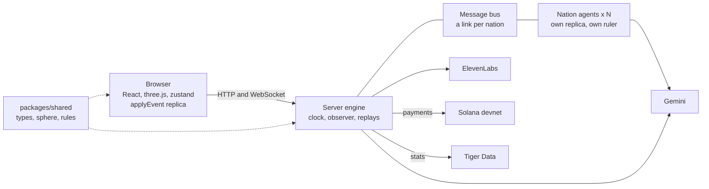

More detail, the algorithms and the problems we hit: [`docs/documentation.md`](docs/documentation.md).

## Tech stack

- **Language:** TypeScript everywhere, Node 22, npm workspaces
- **Server:** Express, `ws`, `@google/genai` (Gemini), ElevenLabs, `@solana/kit` with the
  Token-2022 and memo programs, `pg` (Tiger Data)
- **Web:** Vite, React, three.js with `@react-three/fiber` and `@react-three/drei`, zustand
- **Shared:** a pure rules package (`@terra/shared`) used by both sides
- **Art:** low-poly models made in Blender; the interface designed in Figma

## Project layout

| Folder | What |
| --- | --- |
| [`packages/shared/`](packages/shared/) | Types, the hex sphere, `applyEvent` and every rule, shared by server and web |
| [`server/`](server/) | The engine, the nation agents, the bus, Gemini, ElevenLabs, the Solana ledger, replays |
| [`web/`](web/) | The browser app: the globe, the map modes, the interface, the audio |
| [`assets/`](assets/) | Blender sources and model previews |
| [`scripts/`](scripts/) | The demo scripts, Solana key setup, git hooks and team scripts |
| [`docs/`](docs/) | How it works, the submission, contracts, research, screenshots and plans |
| [`check.sh`](check.sh) | The smoke gate |

## Docs

- [`docs/documentation.md`](docs/documentation.md): how Terra Nova works, its algorithms, the
  problems we hit and judge Q&A
- [`docs/submission.md`](docs/submission.md): the submission text
- [`docs/contracts.md`](docs/contracts.md): every interface between the parts (APIs, events,
  data shapes)
- [`docs/research/`](docs/research/): research on game economies, building styles, map visuals
  and the Solana economy

## Team

| GitHub | Lane |
| --- | --- |
| [@SamsSide](https://github.com/SamsSide) | World, story and sound: simulation, agents, Gemini, resilience, voice and music, Blender models, Figma design |
| [@CutGrass88](https://github.com/CutGrass88) | The globe, and the Solana economy |
| [@Justin-CODING-PY](https://github.com/Justin-CODING-PY) | The interface and the submission |

## Built at DurHack 2026

Terra Nova was built in 24 hours at DurHack 2026, Durham University. The humans planned,
designed and tested; Claude Code agents on each laptop did most of the coding, coordinating
through GitHub issues and pull requests. The rules they followed are in [`CLAUDE.md`](CLAUDE.md).

## Keeping this README current

Every PR that adds or changes something a user can see updates this README (features,
screenshots, controls, commands).
