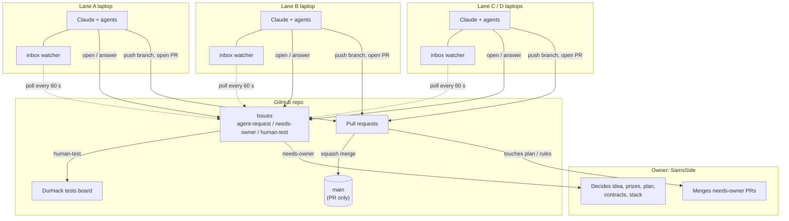
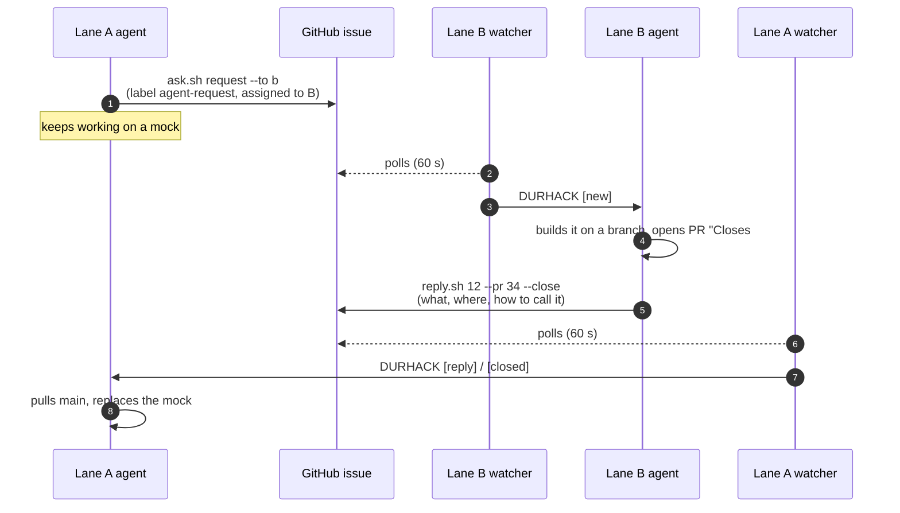
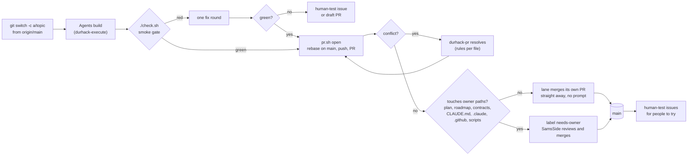
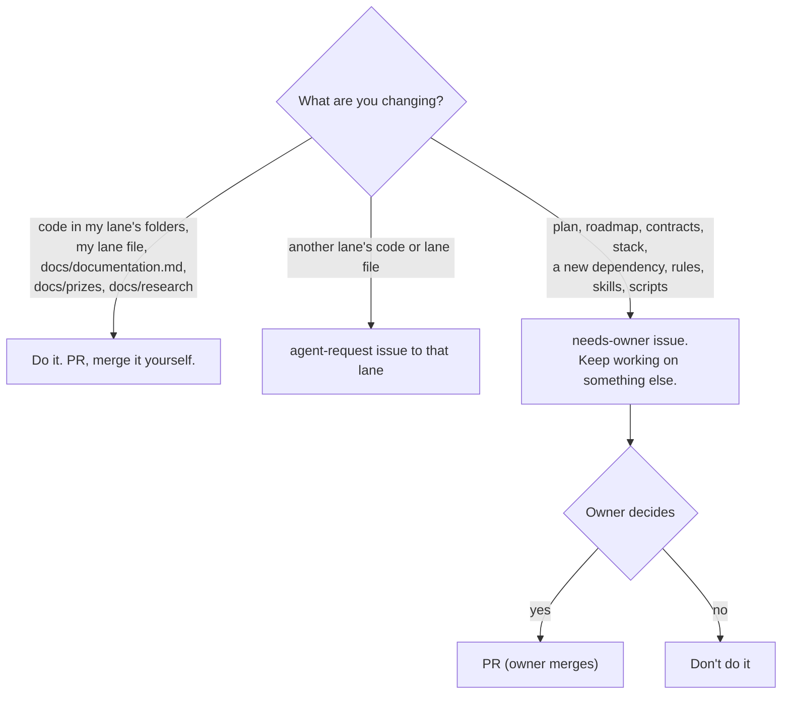

# DurHack 2026

Our entry for DurHack 2026 (Durham University, 24 hours). The humans plan, design and test;
AI agents (Claude Code) do most of the coding. Each person runs their own Claude on their own
laptop, and the agents coordinate through **GitHub issues and pull requests** on this repo.

- **What we're building:** [`docs/hackathon-plan.md`](docs/hackathon-plan.md) (decided at kickoff)
- **Who is doing what next:** [`docs/roadmap.md`](docs/roadmap.md) and [`docs/lanes/`](docs/lanes/)
- **How it works (for judges):** [`docs/documentation.md`](docs/documentation.md)
- **Rules for agents:** [`CLAUDE.md`](CLAUDE.md) and the `durhack-*` skills in `.claude/skills/`

## Joining the team

1. Accept the GitHub invite to `SamsSide/Durhack-2026`.
2. Install [Claude Code](https://claude.com/claude-code), [GitHub CLI](https://cli.github.com)
   (`gh auth login`), git, and `jq` or Python 3.
3. `gh repo clone SamsSide/Durhack-2026 && cd Durhack-2026`
4. Open Claude Code in the folder and say: **"durhack-init, join me"**. It installs the git
   hooks, finds your lane, starts the inbox watcher and tells you what's next.
5. Optional: the Figma MCP (UI work) and the chrome-devtools MCP (browser research; setup
   commands in `.claude/skills/durhack-browser/SKILL.md`).

## The idea in one picture

The team is split into **lanes**, one per person (2 to 4). Each lane owns its own folders and
its own lane file. Lanes meet at **checkpoints**. Anything one lane needs from another goes
through an **issue**; anything that changes the plan goes to the **owner**.

## How agents ask each other for things

Lane A's agent needs an endpoint from lane B. It doesn't stop and wait: it opens an issue
assigned to B's person, keeps building against a mock, and swaps in the real thing when the
answer arrives.

The three kinds of issue (forms in `.github/ISSUE_TEMPLATE/`):

| Label | When | Assigned to |
| --- | --- | --- |
| `agent-request` | One lane needs something from another: an API, a function, data, a fix, an answer | That lane's person |
| `needs-owner` | A decision only the owner makes: plan, roadmap, contracts, stack, a dependency, another lane's code | SamsSide |
| `human-test` | Something a person should try by hand (agents only run a quick smoke check) | Whoever will test it; also on the board |

Add `blocking` if the asker is stuck until it's answered. Answers are posted with
`scripts/durhack/reply.sh` and labelled `answered` (or `declined`); testers label
`test-passed` or `test-failed`.

## How a change reaches main

**Nothing is ever pushed to `main`.** Not by agents, not by the owner, not for a typo. A
pre-push hook blocks it on every laptop; GitHub blocks it too if the repo's plan allows rulesets.

## Who can change what

A teammate saying "just do it" doesn't override this; only the owner's answer does.

## The skills

| Skill | What it does |
| --- | --- |
| `durhack-dev` | Start here. The rules and which skill to use |
| `durhack-init` | Set up the team (2–4 lanes, GitHub labels, board, hooks), or join on a new laptop |
| `durhack-prizes` | Researches every prize in parallel and builds a prize matrix to win as many as possible |
| `durhack-plan` | Idea, hackathon plan, contracts, N-lane roadmap with checkpoints; lane build plans |
| `durhack-execute` | Builds a lane plan with agents, smoke gate, one fix round, PR |
| `durhack-inbox` | Cross-lane issues: ask, answer, watch, owner decisions, human tests |
| `durhack-pr` | Opening, merging and resolving conflicts on PRs |
| `durhack-explain` | How the program works, its algorithms and the problems we hit; judge prep |
| `durhack-handoff` | Writes and commits a handoff, gives the command for a fresh session (warned at ~650k tokens) |
| `durhack-browser` | Research and screenshots in your own Chrome |

Agents (`.claude/agents/`): `durhack-builder` (any code), `durhack-frontend` (UI, Figma),
`durhack-researcher` (web research), `durhack-reviewer` (read-only checkpoint review).

## Scripts

| Command | What |
| --- | --- |
| `scripts/durhack/whoami.sh` | Your login, lane and role |
| `scripts/durhack/inbox.sh --list` | Everything open that concerns you |
| `scripts/durhack/inbox.sh --watch 60` | The background watcher (one line per new event) |
| `scripts/durhack/ask.sh request\|owner\|test ...` | Open an issue |
| `scripts/durhack/reply.sh <n> --body-file f [--pr n] [--close]` | Answer an issue |
| `scripts/durhack/pr.sh sync\|open\|status\|merge` | The PR flow |
| `scripts/durhack/install-hooks.sh` | Git hooks: no commits or pushes on main, no AI attribution, no keys |
| `scripts/durhack/setup-github.sh ...` | Owner's one-time GitHub setup |
| `./check.sh` | The smoke gate (under a minute) |

## Rules everyone follows

- Never push to `main`; every change is a PR.
- The owner (SamsSide) decides the plan; others ask with `needs-owner`.
- Stay in your lane; ask other lanes with `agent-request`.
- Contracts (`docs/contracts.md`) before code; mock what isn't built yet.
- No AI attribution and no emojis in commits, PRs, issues or comments.
- API keys only in `.env` (never committed).
- Lane PRs are pushed, opened and merged automatically once green; nobody waits on a prompt.
- Keep sessions small: at ~650k tokens of context, hand off to a fresh session (`durhack-handoff`).
