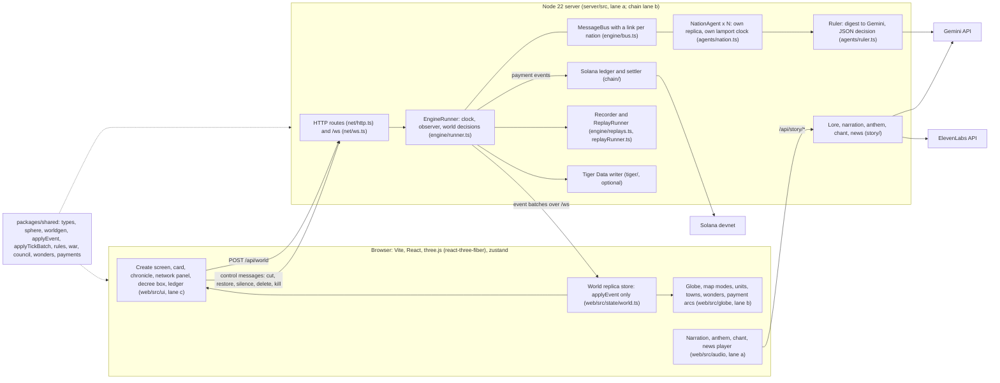
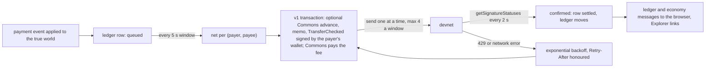
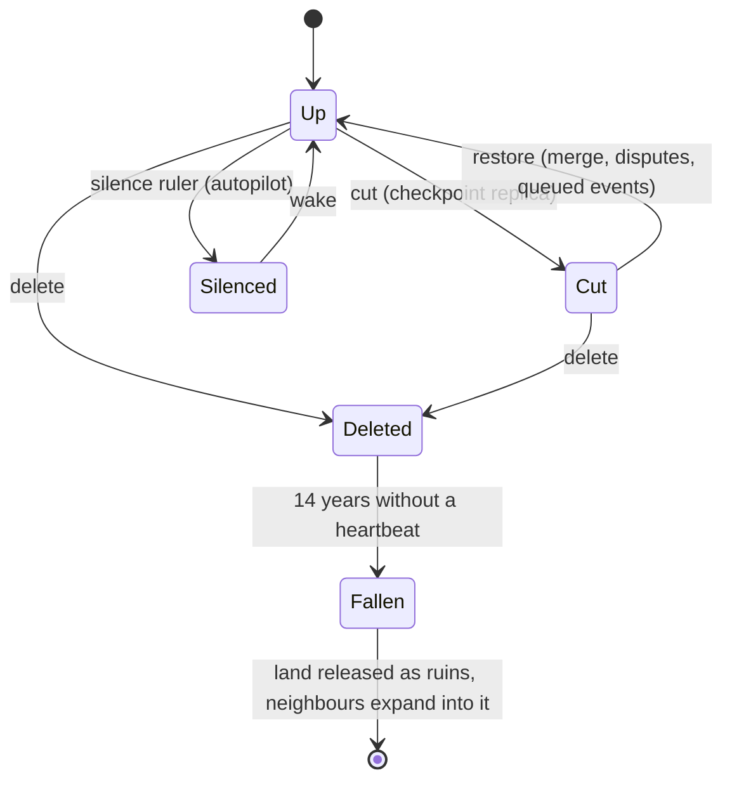

# DurHack 2026 — How Terra Nova works

*Kept current by `durhack-explain`. The code is the truth: where this and the code disagree,
fix this. Anyone may edit; it is the judges' briefing. Last rebuilt 14 Nov from `main` at
`f649a36`. File references are relative to the repo root.*

## 1. Summary

Terra Nova turns one line of text ("a drowned post-apocalyptic world"), and optionally a picture,
into a living 3D planet. Gemini writes a world bible (nations, leaders, ideologies, founding
myths); code generates about 1,200 provinces on a sphere and places the nations; then every nation is
run by its own independent agent with its own copy of the world and its own Gemini ruler. Nations
settle, build, trade, pay each other, move through the ages from spears to starships, raise
wonders, fight wars province by province, lose generals and crown successors. You can cut a
nation off, silence its ruler or delete it, and the world carries on; restore it and its missing
years merge back in with border disputes settled on screen. Every nation has a narrated history, an
anthem sung from what actually happened to it and a war chant (ElevenLabs), and every coin that
moves between nations is a real token transfer on Solana devnet, signed by the paying nation's
own wallet.

One sentence: **a new world, composed live by AIs that keep working together when they cannot
talk to each other.**

## 2. Architecture

What exists on `main` (not the plan):



- **One language, one rulebook.** TypeScript everywhere; `@terra/shared` holds the types and every
  rule, so the server's agents and the browser apply exactly the same code.
- **The world is an event log** (event sourcing). `applyEvent(world, event)` in
  `packages/shared/src/world.ts` is the only code that changes a `World`. Contracts: X1 to X7 in
  [`contracts.md`](contracts.md).
- **External services:** Gemini (bible, rulers, lore, decrees, news, chant lyrics), ElevenLabs
  (speech and music), Solana devnet (the ledger), Tiger Data (optional time series). Every one of
  them is optional: `LLM_MODE=mock` and `SOLANA_MODE=mock` (the defaults) run the whole world with
  no network calls.

## 3. How a request flows (the demo path)

```mermaid
sequenceDiagram
  participant B as Browser
  participant S as Server (runner)
  participant G as Gemini
  participant A as Nation agents (x N)
  participant C as Chain module
  B->>S: POST /api/world {prompt, nations, era, seaLevel, image?}
  S->>G: world bible (flash-lite, JSON schema, image if given)
  G-->>S: nations, names, temperaments, flags, styles
  S->>S: generateWorld(bible, seed): provinces, terrain, regions, capitals
  S-->>B: snapshot over /ws
  loop every tick (one year; 2 a second at 1x)
    S->>A: turn(tick) in a seeded shuffled order
    A->>A: nationTurn on own replica, own events only
    A->>S: events via the bus
    S->>A: each batch to every connected agent
    A->>A: applyTickBatch(replica, batch)
    S->>S: applyTickBatch(true world, batch)
    S-->>B: events; browser applyEvent
    S->>C: payment events (async, never awaited)
  end
  A-)G: ruler digest every 30 to 45 s (fire and forget)
  G--)A: focus, target, stance changes, proclamation
```

1. **Create.** `POST /api/world` (`server/src/net/http.ts`) calls `EngineRunner.newWorld`
   (`server/src/engine/runner.ts:83`). `prepareWorld` (`engine/bibleAi.ts:280`) picks a seed and asks
   Gemini for the world bible; on any failure the deterministic `mockBible` is used.
2. **Generate.** `generateWorld(bible, { seed, seaLevel })` (`packages/shared/src/sim/worldgen.ts:281`)
   builds the planet; the runner starts one `NationAgent` per nation, each with a clone of the
   world (`cloneWorld` shares the static tiles), and a fresh LLM budget (`resetRun`).
3. **Tick.** `runTick` (`runner.ts:180`) rings the clock, lets every live agent take its turn in an
   order shuffled by `mulberry32(hash("order:seed:tick"))`, flushes the bus, then makes the world's
   own decisions: deleted nations collapsing, secession, council deaths and successions.
4. **A nation's turn** (`agents/nation.ts`, `turn`): it runs `nationTurn` (`sim/rules.ts:163`) on its
   own replica with its policy (the ruler's last focus, or `autopilotPolicy` from its temperament)
   and an rng seeded by `turn:seed:tick:id`. It returns only that nation's own events: claims,
   buildings, armies, marches, diplomacy, payments, age progress, wonders, unrest. Each event gets
   the next number on the agent's lamport clock. Then a heartbeat.
5. **The bus** (`engine/bus.ts`) hands each batch to every agent whose link is up and to the
   observer (the true world). Every receiver applies it with `applyTickBatch` (`sim/sync.ts`).
6. **The browser** gets the applied events over `/ws` and applies them with plain `applyEvent`
   (`web/src/state/world.ts:83`): battles were already settled, so it never re-settles them.
7. **Rulers** are called outside the tick loop (`runner.ts:234`), at most one per step, and their
   answer is applied as that nation's own events on its next turn.

## 4. Algorithms and models

### 4.1 Spherical Voronoi provinces

- **What:** a spherical Voronoi diagram of jittered Fibonacci-lattice points, computed as the dual
  of their 3D convex hull. `packages/shared/src/sphere.ts`, `generateProvinces`.
- **How:** place `n` points on a Fibonacci spiral (golden-angle steps, even area), jitter each by up
  to 0.4 of the mean spacing with a seeded rng and push it back to the unit sphere. The convex hull
  of points on a sphere is their spherical Delaunay triangulation (quickhull3d). Each triangle's
  outward normal is its circumcentre on the sphere; a province's boundary is the ring of
  circumcentres of the triangles around its point, so every province is a convex polygon and its
  neighbours are the points it shares an edge with.
- **Complexity:** O(n log n) for the hull, O(n) to build cells. n = 1,200 by default: a few
  milliseconds.
- **Why:** irregular provinces read as a political map (the owner's call, `decisions.md` 15:20);
  hexagons were the fallback and were never needed. Fibonacci points give near-uniform cell sizes
  with no relaxation step (Lloyd relaxation would have cost iterations for little gain).
- **Weakness:** cells near the poles of the spiral are slightly less regular; the jitter hides it.
- **Terrain:** 3 to 5 continent "blobs" placed far apart, domain-warped by fractal value noise for
  ragged coasts, plus noise; the sea level is a percentile cut (`seaLevel` of the cells become
  ocean). Biome by latitude, height and a moisture field: ice, coast, mountain, hills, desert,
  forest, plains (`worldgen.ts`, `buildTerrain`).
- **Regions and capitals:** regions grow over the land graph; capitals go to the larger landmasses
  (at least two nations per landmass used, so everyone has a neighbour to meet) and are spread by
  farthest-point sampling weighted by good terrain (`allocate`, `placeCapitals`).
- **References:** K. Q. Brown, "Voronoi diagrams from convex hulls" (1979);
  [quickhull3d](https://www.npmjs.com/package/quickhull3d).

### 4.2 Determinism: replicas that agree without a referee

The core technical claim: every nation's agent, the server's true world and the browser hold the
same world without anyone being in charge.

- **Seeded randomness only.** `mulberry32` (a 32-bit PRNG) seeded with an FNV-1a hash of a string key
  (`packages/shared/src/rng.ts`). Every roll has a key: `turn:seed:tick:nation`,
  `battle:tile:tick:unit:defenders`, `assassin:seed:tick:nation`, `pay:trade:a:b:tick`, and so on.
  No `Math.random` in the rules.
- **Deterministic ids.** A nation's events are `e-<nation>-<tick>-<n>`; events derived from a move
  are `<move id>-w<k>`. Two replicas derive byte-identical events.
- **Canonical order.** `orderEvents` (`sim/sync.ts`) sorts a batch by lamport timestamp, then actor,
  then position, with payments last (see 4.9). Lamport clocks: each agent numbers its events and
  jumps past any higher number it hears.
- **Same-tick clashes.** Two nations claiming one free province in the same tick: the lowest
  `hash(tile:tick:nation)` wins (`resolveClaim`, `sim/rules.ts:75`).
- **Validation.** `isEventValid` drops events that are no longer legal on this replica (a claim on
  land someone took first, a move of a dead unit).
- **Battles are derived, not reported.** An army's `unit_moved` into an enemy province is only an
  intent; every replica runs `settleMove` (`sim/war.ts:131`) on it in the same order and derives
  the same battle, losses, capture, plunder, fall and general's death.
- **World decisions in one batch.** Things no single nation can decide (secession, a deleted
  nation's fall, assassinations and successions, decrees, dispute settlement) are computed by the
  runner from the true world with pure functions and delivered as one batch of `actor: 'world'`
  events that every replica applies.
- **Replays.** Every live run is recorded (`engine/replays.ts`). `ReplayRunner` plays the log with
  `applyEvent` only, never `applyTickBatch`, so battles are not settled twice. Gemini rulers are not
  deterministic (and the scheduler jitters with `Math.random`), so the log, not the seed, is the
  record of a run. `server/scripts/check-replay.ts` records a 200-tick run with a cut, a restore and
  a delete, replays it and checks the final worlds are identical.
- **Weakness:** a cut nation's replica deliberately drifts from the truth (that is the demo); it
  re-converges on restore. There is no automated check that every connected replica equals the
  truth at every tick; the design (same batches, same order, pure functions) and the replay check
  are the evidence.
- **References:** [Lamport timestamps](https://en.wikipedia.org/wiki/Lamport_timestamp);
  [event sourcing](https://martinfowler.com/eaaDev/EventSourcing.html);
  [FNV hash](https://en.wikipedia.org/wiki/Fowler%E2%80%93Noll%E2%80%93Vo_hash_function).

### 4.3 Battles

`resolveBattle` (`sim/war.ts:92`), called from `settleMove`. A pure function of
`{ attack, defend, terrain, fort, seed, ageGap }`.

```
attack  = army strength x 0.7 if a fleet raids land
                        x 0.8 if an army lands from the sea      (LANDING_PENALTY 0.2)
                        x 0.85 while its general's seat is vacant or cut (COVER_STRENGTH)
defend  = (defending units + garrison) x (1 + wonder defence bonus)
garrison = (3 + min(15, population / 20000) + settlement or fort value) x age strength
A = max(0.5, attack x 1.15^max(0, ageGap))
D = max(0.5, defend x 1.15^max(0, -ageGap) x (1 + terrain defence) x (1.5 if fort or capital))
P(attacker wins) = A^1.6 / (A^1.6 + D^1.6)
```

- One `mulberry32` stream seeded from `hash(battle:tile:tick:unit:defenders)` gives the roll and a
  loss factor. A winning attacker loses 25 to 60% of the defence (less with an age lead); a losing
  one loses 35 to 70% of its own strength.
- **The model** is a contest success function (the Tullock form) with exponent 1.6, between
  Lanchester's linear law (1) and square law (2): a much larger army nearly always wins, an even
  fight is a coin toss. Terrain defence: forest +25%, hills +40%, mountain +75%, desert +10%, ice +20%.
- **Consequences** (all derived on every replica): units removed, the province captured, the
  capital demoted to a city, buildings razed (25%, wonders 20% to ruins), plunder or seizure paid
  (4.9), the nation falls if it is down to its last few provinces or lost its capital and is small
  (`shouldFall`), and the loser's general may die (4.6).
- **Complexity:** O(units + structures) per attack. Fine at demo scale (hundreds of units).
- **Why not an LLM or a referee:** a battle every few ticks at ten years a second must be instant, cheap and
  agreed by every replica with no messages.
- **Reference:** [Lanchester's laws](https://en.wikipedia.org/wiki/Lanchester%27s_laws).

### 4.4 Terrain effects

One table, `TERRAIN_EFFECTS` (`sim/terrain.ts`), read by the sim, the rulers' digests and the globe.

| Terrain | Defence | Supply | Attrition / yr | Move (yrs) | Income | Pop cap |
| --- | --- | --- | --- | --- | --- | --- |
| plains, coast | 0 | 1 | 0 | 1 | 0.9 | 900 |
| forest | 0.25 | 0.8 | 0 | 2 | 0.55 | 500 |
| hills | 0.4 | 0.7 | 0.01 | 2 | 0.6 | 500 |
| mountain | 0.75 | 0.5 | 0.03 | 3 | 0.35 | 150 |
| desert | 0.1 | 0.5 | 0.04 | 2 | 0.25 | 250 |
| ice | 0.2 | 0.4 | 0.05 | 3 | 0.1 | 80 |

- **Move:** a land unit takes `move` years to enter a province.
- **Supply:** an army's upkeep is divided by the supply of the ground it stands on, so a campaign in
  the mountains costs twice as much.
- **Attrition:** an army outside its own land loses `attrition x strength` a year
  (`unit_attrition`, `sim/rules.ts:453`), or disbands if that would leave it with 2 or less.
- **Landing:** an army attacking from the sea fights at 80%.

### 4.5 Technology ages

`sim/ages.ts`. Seven ages: ancient, medieval, gunpowder, industrial, modern, future, stellar.

- The start age comes from the era text by keyword (`startAge`); ruined, drowned and
  post-apocalyptic worlds start in the ancient age so every demo shows the whole climb.
- Each year a nation gains progress `0.5 + per town 0.22 + per city or capital 0.5 + per factory
  0.7 + temples and ports + 0.3 per trade pact or alliance (max 3) + treasury/400 (max 1) +
  population/40000 (max 3)`. Thresholds (cumulative): 260, 1150, 2900, 4800, 8600, 13000.
- Crossing a threshold is the nation's own `country_updated { techAge }` plus a chronicle line, so
  every replica sees it at the same tick. Units raised in an age are stronger (x1, 1.3, 1.8, 2.6,
  3.8, 5.2, 7, capped at 150 strength); battles give 1.15 per age of lead. Stellar nations launch up
  to four satellites. Progress is kept in the agent's memory, not the world.

### 4.5a How the prompt shapes the world

One line of text (and an optional picture) sets far more than the names. The lore model writes the
world bible once; everything after it is seeded code, so the same bible and seed always give the same
planet. Three layers, each checked by the next (`server/src/engine/promptShape.ts`, `bibleAi.ts`,
`packages/shared/src/sim/worldgen.ts`):

1. **The words of the prompt, by rule.** Plain keyword rules read the prompt and the chosen era for a
   setting (`ERA_KINDS` in `sim/ages.ts`: stone, bronze, classical, medieval, sail, industrial, modern,
   near future, far future, post-apocalyptic), a year it names ("in 1349", "900 BC", "17th century",
   "the 1920s"), the planet (`shapeFromText`: drowned or archipelago means a high sea and many
   landmasses, one great continent means one landmass and a low sea, frozen means cold, desert means
   hot and dry, jungle means hot, wet and wooded), a nation count ("seven kingdoms"), the kind of
   state ("whaling republics", "tribes"), and a lean on every temperament (war, trade and faith words).
   The template bible (mock mode, or a failed call) is built from these alone.
2. **The model.** In live mode Gemini also returns `startYear` and a `shape` object in its JSON, told
   the same year spans and examples. `repairBible` then checks it against layer 1: a year the prompt
   names wins; a model year outside the setting's span is pulled into it; a shape field the prompt's
   own words set wins, and the model fills the rest. With a picture, the model first says what it sees
   (`imageReading.subject`) and lets it drive the era, year, shape, styles and colours; the words win
   where they disagree with the picture.
3. **Worldgen.** `generateWorld` applies `bible.shape`: the sea level (the Create screen's slider wins
   once moved off its 0.55 default), one wide blob, a few, or 11 to 16 small ones for the landmasses,
   the ice line (latitude 0.9, 0.7 when cold, 0.97 when hot), the desert belt and the moisture cuts for
   desert and forest, and the height cuts for hills and mountains. On a shaped planet a capital must
   stand on ice-free ground with four ice-free provinces joined to it. With no shape, every constant
   and the random stream are the old ones, so an old seed gives its old planet. Capitals also keep to
   landmasses with room: where the old split would put a nation on a landmass under 8 ice-free provinces
   (or more than one per 8 on it) and the planet has bigger ones, the nations go to those instead.
   Nation colours are made distinct after the bible is repaired (`engine/nationColors.ts`, used by the
   model path and the template path): any colour within 0.09 of an earlier one in OKLab (or near the sea,
   ice or blank map) moves to the hue farthest from the colours taken, and its flag follows.

**Year and age together.** `bible.startAge` is the setting's age (stone, bronze and classical start
ancient; medieval, sail as gunpowder, industrial, modern; the far future starts in the future age;
after a fall the survivors start ancient again), or, for a prompt with only a year, the latest age
that year allows. The calendar gates (`AGE_EARLIEST_YEAR`, satellites from 1957) are unchanged: they
only stop a nation stepping up early, so a clockwork world founded in 1780 starts industrial and may
turn modern from 1900, while a stone age world founded in 9000 BC stays ancient until the year 500.

**Building styles.** Each setting has a list of styles that fit it (`KIND_STYLES`); a style from the
model or the rules that is not on it is swapped for the least-used one that is, the climate's first
(norse and highland on ice, desert and egyptian on sand, mesoamerican in jungle).

**Proof.** `npx tsx server/scripts/check-prompt.ts` founds eight worlds from one seed and fails unless
they differ as their prompts ask (ice, desert, forest and sea shares, landmass counts, start years
and ages, styles); `--live` does the same with Gemini writing each bible, `--image <file>` checks
the picture path.

### 4.6 The council: deaths, cover, succession, coups

`sim/council.ts` (pure) and `server/src/engine/council.ts` (the `CouncilKeeper`).

- Every nation has a **ruler** (sets focus and stance: Gemini or autopilot) and a **general** (moves
  the armies). Seat states: `active`, `covering`, `vacant`, `cut`.
- **Deaths.** A general can fall when his side loses a battle of combined strength 50 or more, with
  25% chance, rolled from the battle seed (so every replica derives it). Assassination: 1 in 400 a
  year per nation, x3 at war, one seeded roll per nation per year. A demo control (`kill`) and a
  decree ("assassinate the king") can kill a member too.
- **Cover.** When a seat is vacant or cut, the other member covers: armies attack at 0.85 while the
  ruler covers the general; while the ruler's seat is empty or cut the nation runs on autopilot.
- **Succession** 8 years later. The successor's title follows the government (heir, election,
  appointment) and **inherits the predecessor's memory**: a rolling five-line summary written by
  `applyEvent` from the battles and wars it lived through (`world.ts`, `councilMemo`). In a military
  or autocratic government a ruler's death ends in a **coup** 30% of the time: the general takes the
  throne and leaves his own seat empty.
- **Why the world decides:** deaths and successions affect several replicas at once, so they are
  computed from the true world and delivered as one batch, like secession.

### 4.7 Wonders

`sim/wonders.ts`. A nation at peace, past year 120, with 240 or more in the treasury, may start a
wonder near its capital (2.5% a turn once it qualifies; cost 160). The kind follows its
architecture (cathedral, pyramid, great wall, colossus, mausoleum, palace of soviets, skyscraper, a
space elevator in the future and stellar ages). It takes 40 years to build. At most 2 per nation,
4 per world, begun at least 70 years apart. A finished wonder gives the whole nation +10% income,
+15% defence or -1% unrest a year; captured wonders change hands and 20% are razed to ruins. All
rolls are hashes of the world, so every replica agrees.

### 4.8 Regions, unrest and secession

`sim/regions.ts`, `server/src/engine/secession.ts`. Each nation publishes the unrest of its regions
every 5 years, from distance to the capital, recent conquest, foreign provinces, war exhaustion,
battles and the gap between the ruler's and the region's temper; unrest moves towards its target by
at most 0.12 a review. From year 150, a region over 0.8 unrest with 6 or more provinces may break
away (8% a check, one at a time, 120 years apart, never the same region twice, at most 16 nations).
The breakaway becomes a new nation with its own agent and ruler: a new actor joining mid-run.

### 4.9 Payments and money conservation

`sim/payments.ts`, `settleMove` in `sim/war.ts`, `applyTickBatch` in `sim/sync.ts`.

- **Sources:** goods-market bills (every 5 years per buyer, one merged bill to each seller for the
  goods it bought, capped at 15% of the buyer's treasury, bills under 8 skipped); reparations the year after a peace from the side that lost ground
  (15 to 40%); plunder of a sacked town or city (7 or 12% of the defender's treasury); seizure of a
  fallen capital (30%, or 70% if the nation falls); war chests from allies not in the war (12%);
  pooled funds between allies fighting together (20% from the weaker); subsidies from a strong rich
  nation to a weak friend (10%). About 44 to 62 payments in a 600-year world.
- **Each nation only pays out of its own treasury**, decided on its own replica from shared state
  and seeded hashes. Plunder and seizure are derived in the battle, so every replica derives them.
- **The ordering bug and its fix.** A nation's `country_updated` carries its *absolute* new treasury
  (income minus upkeep, computed before the batch). A payment applied before it was silently
  overwritten: money vanished from payees or appeared from nowhere. Fix: `orderEvents` sorts
  payments last, `applyTickBatch` holds derived payments back and applies them after everything
  else, and each payment is clamped to what the payer holds at that moment; the logged amount is
  what really moved. `applyEvent` clamps again, so a replay agrees.
- **Proof:** `server/scripts/check-money.ts` runs 600 headless ticks and, each tick, compares the
  treasury total with and without the batch's payments: they must match to the cent. It also checks
  no treasury goes negative and the log replays to the same treasuries. Last result (PR #180):
  `MONEY CONSERVED`.

### 4.10 The Solana bridge

`server/src/chain/` (lane b since 14 Nov 17:50). `SOLANA_MODE` = `off`, `mock` (default, fake
signatures, no network) or `devnet`.



- **The sim is the truth; the chain is an exact ledger of money moving between nations.** Income
  and spending never leave the sim. The chain never makes the tick loop wait: everything is async,
  caught, backed off and behind a breaker (5 failed windows in a row pause sending for 30 s; the
  panel shows payments waiting).
- **Genesis** (`chain/genesis.ts`), once per world: a Token-2022 mint ("<World> Crown", symbol TNC,
  2 decimals) with on-chain name and symbol, a fixed supply of 1,000,000 minted to the Commons and
  the **mint authority revoked**; one token account per nation and one for the Commons, each with
  the MemoTransfer extension (incoming transfers must carry a memo); a float of 10,000 TNC
  (`SOLANA_FLOAT`) to every nation. One wallet per nation, keys outside the repo
  (`SOLANA_KEYS_DIR`).
- **Netting:** queued rows are summed per (payer, payee) each window (`chain/index.ts`, `groups`).
  If the payer's ledger, less what it has in flight, cannot cover a group, the Commons advances the
  difference in the same transaction (with its own memo).
- **Each transaction:** a memo (`TN <first row id> y<year> <reason>: <note>`, under 190 bytes, so
  two identical payments never share bytes) then a `TransferChecked` signed by the paying nation's
  own key. The Commons is the only fee payer, so only one wallet needs SOL.
- **Built for the public devnet RPC** (100 requests per 10 s per IP): a fixed compute-unit limit and
  no priority fee, so nothing is simulated before sending; sends one at a time; confirmation by HTTP
  polling (one batched `getSignatureStatuses` every 2 s while anything is in flight), never
  WebSocket subscriptions; balances read every 30 s with one `getMultipleAccounts`. About 30 to 40
  RPC calls a minute.
- **No double pay:** a signed transaction keeps its signature until it is confirmed, fails on chain,
  or provably can no longer land (its blockhash expired and the signature is unknown). Only then is
  it rebuilt with a fresh blockhash. A resend of a group already in flight is ignored.
- **Honesty check:** per nation, `ledger = float + confirmed in - confirmed out + advances` and
  `onChain` (read from devnet) must agree; `drift` is reported in `GET /api/economy`.
- **Replays** send nothing; a sidecar `server/replays/<id>.ledger.json` keeps the real signatures
  from a recorded live run so Explorer links still open.
- **Libraries:** `@solana/kit` 8.6, `@solana/kit-plugin-rpc` and `-signer` 0.23,
  `@solana-program/token-2022` 0.20, `@solana-program/memo` 0.16 (never `@solana/web3.js`).

### 4.11 Resilience: cut, silence, delete, restore

`engine/bus.ts`, `engine/resilience.ts`, `agents/nation.ts` (`onCut`, `rejoin`), `engine/runner.ts`
(`onRestore`, `onDelete`, `collapseDeleted`).



- **Cut link.** The agent keeps running on its own replica: nothing gets in or out. Its events queue
  in its outbox; the batches it should have heard queue in its inbox; heartbeats are not queued
  (silence is the point). Its "beliefs" drift from the truth and the browser can show them. After
  12 years without a heartbeat each neighbour writes one line in the chronicle, in the voice of the
  era ("the telegraph lines go dead"), and an aggressive neighbour may turn hostile.
- **Restore (reconciliation).** The agent rebuilds from the checkpoint taken at the cut: it applies
  every batch it missed in order, then the settlement, then its own queued events as one batch.
  Every other replica applies the same settlement and queue in the same order, so all agree again.
- **The dispute rule** (`findDisputes`): every claim the returning nation made on a province the
  connected world gave to someone else meanwhile is a dispute; **the earlier claim wins** (claim
  ticks are in the log both sides now share), a tie goes to the `resolveClaim` hash. It reads as
  fair, it does not depend on which link came back first (a blackout restored in any order settles
  the same way) and it is a pure function of shared data. Disputes are written into the chronicle
  ("three border provinces were disputed; two went to...") and flash on the globe.
- **Silence ruler.** No more Gemini calls: the nation runs on its last focus, then on
  `autopilotPolicy` from its temperament. Hitting the budget cap takes the same path.
- **Delete.** The agent is removed. Neighbours notice the silence; 14 years later the world declares
  it fallen with no conqueror: buildings become ruins, units disband, land is released, and the
  neighbours carve it up by ordinary expansion.
- **Payments while cut** wait in the queue with the rest; on chain nothing moves for that nation
  until restore, when its debts settle in one burst.

### 4.12 The pacing director

`server/src/engine/clock.ts`, `engine/bigMoments.ts`. Speed is continuous from 1/104 to 5 times a base
rate of 2 years a second: one week a second up to ten years a second, shown as ten gears, and new
worlds start at three months a second. The clock turns wall time into whole ticks and carries the
fraction, so the top gear is 10 ticks a second without drift (at most 16 ticks per timer fire). With pacing `auto`, the
chosen speed is a ceiling: a **big moment** (a war declared, a battle for a capital, a fall, a new
nation, a decree, a cut, a return, a dispute) drops the speed to `min(target, 1)` for 8 seconds,
then it eases back exponentially over 3 seconds. Pause always wins. The same director runs in live,
mock and replay.

### 4.13 Gemini: what it does, models and budgets

All calls go through `server/src/llm/index.ts` (`llmJson`): structured output with a JSON schema
(`responseMimeType: application/json`), validated again on return, minimal thinking, a meter of
calls and tokens, and caps. **On any failure it throws and the caller falls back** to a template or
autopilot; it never retries.

| Use | Model (default) | Input | Where |
| --- | --- | --- | --- |
| World bible | `gemini-3.5-flash-lite` (about 5 s; flash took 28 s) | text, plus an optional picture (about 7 s) read for mood, palette, setting and sea level | `engine/bibleAi.ts` |
| Rulers | `gemini-3.5-flash-lite`, max 220 output tokens | a compact digest: treasury, armies, age, neighbours with relative strength and grievance, recent chronicle, rough ground | `agents/ruler.ts` |
| Lore (nation and region) | `gemini-3.5-flash` | the nation and its real chronicle | `story/loreAi.ts` |
| Anthem and chant lyrics | `gemini-3.5-flash` | founding myth plus its wars, losses and allies | `story/loreAi.ts`, `story/chant.ts` |
| Decrees, typed | flash-lite | text, to `{ effect, target }` (plague, famine, storm, flood, meteor, prophet, gold rush, rebellion) | `engine/decrees.ts` |
| Decrees, spoken | flash-lite (about 1.3 s) | the audio clip itself, heard directly | `engine/decrees.ts` |
| Terra Nova News | `gemini-3.5-flash` (about 19 s with the image) | a capture of the globe plus the chronicle, to a bulletin | `story/broadcast.ts` |
| Painted flags | `GEMINI_MODEL_IMAGE` (empty: off) | flag spec to image | `story/paintedFlag.ts` |

- **Scheduling:** each ruler is due every 30 to 45 s (jittered), sooner after a big event (at least
  10 s apart), at most one call per step, 20 calls a minute (`LLM_MAX_CALLS_PER_MIN`) and 400,000
  tokens a run (`LLM_MAX_TOKENS_PER_RUN`). Over either cap every nation drops to autopilot. Lore is
  written on first click and cached on disk per world.
- **Mock vs live:** `LLM_MODE=mock` (the default) never calls Gemini: canned bibles, autopilot
  rulers, template lore and bulletins, a keyword matcher for decrees. The world is fully playable.
  `live` is for demos only, because the budget is shared by the team (owner's cap: 25 pounds for
  Gemini and ElevenLabs together).
- **Why these models:** the 2.5 family is closed to new users; flash-lite is the cheapest for many
  ruler calls and fast enough for the 15-second creation step.

### 4.14 ElevenLabs: what it does

`server/src/story/` (`eleven.ts`, `anthem.ts`, `chant.ts`, `broadcast.ts`, `teamVoices.ts`).

- **Narration:** text to speech (`eleven_multilingual_v2`) reads each nation's lore; the voice is
  chosen from its `voiceStyle` and government.
- **Anthems:** ElevenLabs Music (`music_v1`) with a composition plan: Gemini writes four to eight
  lines from the nation's real history, and the music is shaped by its era and government
  (instruments, tempo, language, mood). No two anthems are alike.
- **War chants:** short shouted chants (`eleven_v3` with the `[shouting]` tag), played when the
  nation declares war or fights.
- **Terra Nova News and the herald:** the team's own cloned voices (Sam, Justin, Denis) take turns
  as news anchors, narrate up to three nations per world, shout some chants and read decrees aloud.
- **Caching and caps:** everything is generated on first need and cached on disk by a hash of its
  content. Caps: 20,000 characters a run (30,000 on the Starter plan), 8 anthems, 12 bulletins;
  above them the routes return 503 and the browser falls back. Mock mode plays bundled samples.

### 4.15 Smaller pieces

- **Diplomacy** (`sim/war.ts`, `diplomacyTurn`): war needs one side; peace, trade and alliance need
  both, through an "offer" chronicle line that the other side reads on its own replica and accepts
  on its own turn. Truces of 50 years; no wars before year 70; broken alliances add grievance.
- **Sea trade** (`sim/trade.ts`): merchant ships sail port to port between trading partners, dock
  for a year and pay both sides; an enemy fleet sinks them.
- **Tiger Data** (`server/tiger/`, optional): every event and each nation's growth go to hypertables;
  it never blocks the tick loop and skips playback.

## 5. Data

- **World** (X1 in [`contracts.md`](contracts.md)): static `tiles` (centre, boundary, neighbours,
  terrain, elevation, region) plus mutable `owner[]`, `countries`, `regions`, `structures`, `units`,
  `relations` (stance, since, grievance), `chronicle`, `agents` (link, ruler, pending events).
- **Events** (`WorldEvent`): `tick`, `tile_claimed`, `structure_*`, `wonder_*`, `unit_*`, `battle`,
  `relation_changed`, `country_*`, `region_updated`, `chronicle`, `payment`, `council_*`. Each
  carries `id`, `tick`, `actor` (a nation, `world` or `decree`) and `lamport`.
- **Replays:** `server/replays/<id>.head.json` and `.ndjson` per live run (git-ignored); the saved
  demo `server/replays/demo-1.json` ("The Drowned Age", 600 years, 7,263 events, re-recorded after
  A28).
- **Caches on disk:** lore per world, narration, anthems, chants, bulletins, flags (`server/.cache`).
- **Ledger:** in memory per world, plus the chain sidecar; on devnet, the token accounts.
- **Secrets:** `.env` (git-ignored); Solana keypairs in `~/.config/durhack/solana`, never in the repo.

## 6. Problems we hit

**The hardest part (1): keeping Solana honest on a public devnet.** The first live run (PR #171)
mirrored every nation's treasury to the chain with a Commons "true-up" every 10 s. On the second
run it fell apart: HTTP 429s from the public RPC, dropped WebSocket subscriptions, "failed to
estimate" compute errors, and drift over 1,000 coins because income changes every tick but the
chain can only move every few seconds. The owner's decision (PR #180): stop mirroring treasuries.
The chain became an **exact ledger of money moving between nations** only, with a 10,000-coin
float per nation, Commons advances when a payer is short, netting per pair per window, fixed
compute-unit limits (no simulation call), HTTP status polling instead of WebSockets, exponential
backoff honouring `Retry-After`, and a "never pay twice" rule tied to blockhash expiry. Lesson: on
a rate-limited chain, put on chain only the thing that is genuinely a transfer, and make it exact.

**The hardest part (2): money that vanished.** The first payment code passed its tests but the
totals did not add up: a nation's `country_updated` sets an absolute treasury worked out before the
batch, so a payment applied earlier in the same tick was overwritten. Payments now go last in the
canonical order, derived ones are held back, and every payment is clamped to what the payer has
(PR #165). `check-money.ts` proves conservation to the cent over 600 years.

| Problem | Why | Fix | Where |
| --- | --- | --- | --- |
| Battles counted twice in replays | Replaying with `applyTickBatch` re-settles battles already in the log | Playback uses `applyEvent` only | PR #102 |
| Two nations claim one province in one tick | Agents decide in parallel on their own replicas | `resolveClaim`: lowest hash wins, the same on every replica | `sim/rules.ts` |
| Demo world drifts as the sim changes | Each new rule changes what a seed produces | The demo is a recorded log, not a seed, so it always replays exactly; `check-replay` guards it; `council` is optional so older logs still load. demo-1 was re-recorded after A28; it predates payments, councils and wonders | `engine/replayRunner.ts` |
| Lore lost between runs | Lore was kept in memory | Written to disk per world, so replays reuse lore and voices with no API calls | PR #107 |
| Parallel agents in git worktrees broke the build | A symlinked `node_modules` breaks npm workspaces | Every worktree runs its own `npm install` | `docs/handoffs/a-2026-11-14-1624.md` |
| The devnet faucet refuses AI agents | faucet.solana.com says agents must not use it | A person funds the Commons wallet; the Commons is the only fee payer, so one wallet needs SOL | `docs/research/solana-economy.md` |
| Gemini 2.5 closed to new users; the bible took 28 s on flash | Model availability and latency | 3.5 flash-lite for bible and rulers (about 5 s), 3.5 flash for lore | `decisions.md` |
| Gemini image generation returned 429 | Image billing not enabled | Flags are drawn from a spec at once; painted flags stay off | row A19 |
| ElevenLabs Music rejected anthem prompts | Its filter refuses prompts naming a national anthem | The bible's wording is softened before composing | `story/anthem.ts` |
| Timers drifted at high speed | Fixed 1/2/4/8 steps and integer ticks per fire | Continuous speed with a carried fraction and the pacing director | PR #136 |
| The hologram card did not look good enough | Design | Docked parchment card; labels always face the camera | PR #80 |

## 7. Limitations and next steps

- **Rulers are not reproducible.** Gemini answers vary, so a live run cannot be re-created from its
  seed; only its log replays exactly.
- **The saved demo (demo-1) predates payments, councils and wonders** (A27, A29, A30). A replay of it
  shows no ledger, deaths or wonders; re-record before judging if those must appear offline.
- **All agents run in one process** on the owner's laptop; cut and restore are software switches on
  the bus, not real network partitions. Agents on other laptops (row A10) were cut.
- **The chain records payments between nations only**, not income; treasuries live in the sim. Devnet may reset,
  which would break old Explorer links.
- **Painted flags** need Gemini image billing and are off.
- **Not signed off by a person** (rows still `testing` in the lane files): the timeline scrubber
  (B9), economy depth (B11), Tiger Data (A11, needs a database URL and is off), anthems and chants
  (A15, A16), future and stellar ages (A26), terrain (A28), councils (A29), wonders (A30).
- **Scale:** rules scan all provinces per nation per turn (O(nations x provinces)); fine at 1,200
  provinces and 16 nations, not tuned beyond.

### Where the code and the plan or contracts differ

None known at the time of writing; the mismatches found on 14 Nov were fixed in the docs.

## 8. Judge prep

*The demo pack is in [`demo/`](../demo/README.md): the script, a one-page cheat sheet, this judge
Q&A and a short "how it works" read, copied from here and from `docs/submission.md` section 3. Fix
the source first, then the copy.*

### The 30-second pitch

"Type a world. Terra Nova builds a planet and gives every nation its own AI: its own copy of the
world, its own Gemini ruler, its own wallet on Solana. Watch them settle, trade, pay each other,
march from spears to starships and go to war. Now cut one off mid-war: it keeps going on what it
last knew. Bring it back and the world merges its missing years and settles the border disputes,
with no central server deciding anything. Every nation has a narrated history, a war chant and an
anthem sung from what really happened to it."

### The 2-minute demo

Given live at the table on the owner's laptop, again for every judge (no video). It starts from a
prepared world a few hundred years in, in presentation mode; the timed script and the reset routine
are in `docs/submission.md` section 3 (copy in `demo/script.md`). The seven beats:

1. Orbit, gears at a few years a second: "a new world composed live by AIs", every nation with its
   own Gemini ruler and its own wallet.
2. **The moment:** cut a nation in the Network panel and press Show beliefs: its map drifts from
   the truth while it keeps ruling.
3. Kill its ruler: a stand-in covers, then a successor inherits the memory. Restore the link: the
   missing years merge in, the dispute is settled by one rule and "the Silence" is in the chronicle.
4. The globe and the money: ten years a second for a few seconds, then click a gold payment arc and
   open it in the Solana Explorer.
5. Ages from bows to starships: two map modes, and a satellite shot down (or the port and sea
   battle beat) if one has happened.
6. Click a nation: the card, its ruler, mood and treasury, its narrated lore and its anthem.
7. Hold the mic and speak a decree ("a plague in the north"); Terra Nova News reports it. Close on
   the closing card (End): the token meter.

A judge can give their own prompt on the Create screen afterwards (the world bible takes about 5 s,
about 7 s with a picture).

**If the live demo breaks:** play the saved replay `demo-1` (World: Saved replay demo-1 in setup, or
`npm run demo:reset -- --replay demo-1`): no API calls, exact replay, cached audio. The failure
plays are in `docs/demo.md` section 6. Mock mode (`npm run mock`) needs no keys. Screenshot of a confirmed devnet
payment: `docs/shots/solana-devnet-payment.jpg`.

### Prize angles

| Prize | The one sentence | Proof |
| --- | --- | --- |
| Neptune North (actors work better together) | Independent agents with a common world, deciding alone, progressing when cut off and merging on return | `agents/nation.ts`, `engine/bus.ts`, `engine/resilience.ts` |
| Marshall Wace (New Worlds) | A new world from one line, with its own history, music and money | the Create screen |
| MLH Gemini | Gemini rules every nation and is multimodal: a picture in, speech in, the map image in for the news | `llm/index.ts`, `bibleAi.ts`, `decrees.ts`, `broadcast.ts` |
| MLH ElevenLabs | Narration, history-driven anthems, war chants, a news anchor in the team's own voices | `server/src/story/` |
| MLH Solana | Every coin between nations is a Token-2022 transfer signed by the payer's own wallet, with a memo | `server/src/chain/` |
| Waterstons (weak fit, one line) | Language models, a simulation, cloned voices, generated music and a public chain connected into one living map | the whole app |
| Main track (Composition) | A world, its history, money and music composed live by many authors | the demo itself |

Not entered (owner rulings), so never present them as entries: MLH Entire (sessions are still
recorded) and MLH Tiger Data (the code is optional and off).

### Likely questions with answers

**Resilience and AI agents (Neptune North)**

1. *Is there really no central controller?* The runner is a clock and an observer. Each nation
   decides only its own events on its own replica. Things no single nation owns (a deleted nation's
   fall, secession, successions, decrees, dispute settlement) are computed from shared data by pure
   functions and published as one batch.
2. *How do replicas agree on a battle no one reports?* A battle is derived from a move by a pure,
   seeded function; every replica applies the same batch in the same order and gets the same result.
3. *What happens to a cut nation?* It keeps playing on stale beliefs, queues its events and is
   noticed as silent by neighbours after 12 years.
4. *How is the merge done?* From a checkpoint taken at the cut: missed batches, then the dispute
   settlement, then its queued events. Everyone applies the same settlement in the same order.
5. *Who wins a disputed province?* The earlier claim, by tick; a tie goes to a hash. Same answer
   whatever order links come back in.
6. *Is it a real network partition?* No. All agents run in one Node process and the cut is a switch
   on the bus. Running agents on other laptops was planned and cut for time.
7. *What if Gemini is down?* Every call has a fallback: autopilot rulers, template lore and bulletins,
   a keyword decree matcher. The world never waits for an LLM.
8. *How do you know replays are exact?* `check-replay.ts` records a run with a cut, a restore and a
   delete, replays it and compares the final worlds field by field.

**Gemini**

9. *Why so few LLM calls?* Rules move the world; the LLM only sets each nation's focus and stance
   every 30 to 45 s. That keeps it cheap, fast and playable with no LLM.
10. *What is multimodal here?* A picture shapes the world bible; a spoken decree is heard directly as
    audio; the news reads a captured image of the globe.
11. *How do you stop bad JSON?* JSON schema output, validated again on our side; any failure falls
    back.
12. *How much does a world cost?* The token meter shows calls and tokens live; caps are 20 calls a
    minute and 400,000 tokens a run. We have not measured an average cost per world yet.

**ElevenLabs**

13. *Is voice core or a button?* Every nation has narrated lore, a chant played automatically in war
    and an anthem written from its own history; the news is read aloud every bulletin.
14. *Whose voices?* Premade voices chosen by culture and government, plus our own cloned voices as
    news anchors and the decree herald.
15. *What if credits run out?* Everything is cached by content hash; caps return 503 and the browser
    falls back; mock mode uses bundled samples.

**Solana**

16. *Why is the chain not the source of truth?* A battle cannot wait 1 to 2 s for a confirmation
    inside a 500 ms tick, exact replays need a local log, and a devnet outage must not freeze the
    world on stage. The sim records the debt; the chain proves it was paid, by whom and when.
17. *Who signs?* The paying nation's own wallet signs the transfer; the Commons pays fees and, when a payer
    is short, an advance.
18. *Can a payment be paid twice?* No: a signed transaction is only rebuilt once its blockhash has
    expired and its signature is unknown to the chain.
19. *What about rate limits?* Netting per pair per 5 s window, at most 4 transactions a window, no
    simulation calls, HTTP polling and backoff: about 30 to 40 RPC calls a minute.
20. *Is the supply real?* Fixed at 1,000,000 with the mint authority revoked at genesis; every
    incoming transfer must carry a memo.

**Process**

21. *How did you split the work?* Three lanes (world and story, globe, interface), a contract file
    for every interface, mocks first, PRs only to `main`, cross-lane requests as GitHub issues.
22. *How did you use AI?* Claude Code agents built most of the code from short plans, one lane per
    person, with a smoke gate on every pull request. Sessions are recorded with Entire and linked to
    commits; we did not enter the Entire prize.

**Technical depth**

23. *Why spherical Voronoi?* It reads as a political map; Fibonacci points give even cells with no
    relaxation; the convex hull gives the triangulation in O(n log n).
24. *How does the battle maths work?* A contest function with exponent 1.6 between Lanchester's
    linear and square laws, plus terrain, forts, landings, age gap, wonders and command.
25. *Does it scale?* Comfortably at 1,200 provinces and up to 16 nations at ten years a second (the top gear) on one
    laptop on a replay (about 50 frames a second, with hitches, under local Gemma);
    the rules scan provinces per nation, so much larger maps would need spatial indexes. We have not
    benchmarked beyond the demo size.

### Table-demo questions (2 minutes, live, one judge at a time)

- *Is this live or a recording?* Live: the real app on this laptop, with a prepared world so we do
  not wait. A saved run can be replayed exactly, with no API calls, if the network fails.
- *Can I give it a prompt?* Yes, on the Create screen; Prepare takes a short while to cache the
  lore and audio, so we start from a prepared world for the two minutes and can build yours after.
- *What am I looking at when you cut a nation?* The nation's own copy of the world, frozen at the
  cut and drifting from the truth while it keeps ruling; the Show beliefs view paints what it no
  longer knows.
- *Is the Solana payment real?* A real devnet Token-2022 transfer signed by the paying nation's
  wallet, with the reason in the memo; click an arc to open it in the Solana Explorer.
- *How much of this is the LLM?* Little: rules and seeded functions move the world; Gemini sets
  each nation's focus every 30 to 45 s and hears spoken decrees; every call has a fallback.

### Added on 14 Nov (afternoon and evening)

Short answers for the features that landed late.

- **Time gears.** Speed runs from a week a second to ten years a second (new worlds start at
  three months a second); the client shows month and day between yearly ticks and units glide, and the
  pacing director still slows for big moments.
- **Prepare mode.** `prepare: true` pauses a new world while lore, narration, chants, anthems and
  each ruler's first decision are made in parallel within the budgets; a readiness panel shows
  progress and a play button appears when done, so the demo never stutters.
- **A living world.** Boats, caravans, birds and smoke, volumetric clouds with weather and storms
  that answer storm decrees; units move at believable speeds.
- **Strategic map.** Armies route by Dijkstra over terrain move cost (round mountains, through
  passes), stop at enemy zone of control, and chokepoint forts hold lines; cities grow walls by
  tier, drawn at close zoom from a derived city tier.
- **Council ageing.** Each member has a birth year; natural death rises from 50 and nobody lives
  past 100, so rulers do not reign for centuries; succession then follows the usual rules.
- **News anchor.** Terra Nova News shows an animated, lip-synced anchor (our own original
  characters and studio) in a broadcast window, with cutaways to the globe capture.
- **Economy depth.** Each province makes a good; shortages, a goods market, devastation, war
  readiness and a politics axis that drifts to extremes under war, shown as map modes and chips.
- **Exact Solana ledger.** Every sim payment is recorded and netted per pair in 5-second windows,
  with a token account opened for nations founded after genesis; balances match the sim (drift 0).
- **Calm UI.** One left panel at a time (nation or province card), small war tabs top right, a
  node-graph network panel and icon map modes by the minimap.
- **Material system.** Shared CSS tokens give panels depth, bevels, engraved names and plated
  badges across every screen (before and after shots in `docs/shots/`).
- **Memory cap.** The chronicle is a recent window (about 500 lines, founding and secession kept)
  trimmed by the shared `applyEvent`; the full log streams from `GET /api/world/log` on disk.
- **Stability fixes.** The payment-arc label loop that froze the tab was removed and the server
  now survives chain and socket errors.
- **Timeline scrubber.** The scrubber rebuilds the globe at any past year from the log.
- **Territory chart (optional, off for the demo).** A Stats tab in the Network panel charts each
  nation's territory from Tiger Data; the tab only exists when `TIGER_DATABASE_URL` is set and the
  database answers. We did not enter the Tiger Data prize.

### How the interface shows it

For each feature: what the judge sees, what is happening underneath, and the one-line answer.

- **The network cut.** *Sees:* the network panel (a node graph, `web/src/ui/network/`) with a cut
  button per nation; that nation greys under a drifting mist, its queued moves pile up as
  wax-sealed letters by its capital with a tag like "silent 42 yrs, 49 queued", and its flag keeps
  playing. *Underneath:* the cut flips the bus link for that one agent (`server/src/engine/bus.ts`,
  `resilience.ts`); the globe reads `agents[].link` and `pendingEvents` (`web/src/globe/show/CutVeil.tsx`,
  `LetterPile.tsx`, `web/src/globe/status/StatusMarkers.tsx`). *Answer:* "Cut means no messages in
  or out, not stopped: the nation keeps ruling on what it last knew, and the letters are its real
  queued events."
- **Show beliefs (the stale map).** *Sees:* select a cut nation, press Show beliefs, and provinces
  it has got wrong pulse with a holo wash and dashed outline; the fill and borders follow its map,
  not the truth. *Underneath:* `belief(id)` returns that nation's own replica (`web/src/state/belief.ts`,
  `useBeliefRefresh.ts`); `web/src/globe/political/BeliefBorders.tsx` marks every tile whose believed
  owner differs from the real one. In mock mode the map is frozen at the cut (PR #231). *Answer:*
  "That is a second, real copy of the world that stopped hearing the news, not a visual effect."
- **Silence and return.** *Sees:* "silence ruler" turns the AI tag into AUTOPILOT; restoring a cut
  nation flies its letters to the other capitals and a cyan ripple lifts the mist; a deleted nation
  goes under a dark veil. Rulers proclaim with a parchment scroll (4.6 s, three at most, none from a
  cut ruler) in `web/src/globe/show/RulerScrolls.tsx`. *Underneath:* silence stops Gemini calls and
  uses `autopilotPolicy`; restore replays missed batches then merges the queue, and the earlier claim
  wins a dispute (section 4.11). *Answer:* "Return is a deterministic merge, so it looks the same
  whichever link comes back first."
- **Council kill and succession.** *Sees:* the Council section of the nation card shows ruler and
  general with ages; Kill asks to confirm (3 s), the seat goes vacant, the other member covers, and
  a successor appears years later. *Underneath:* `web/src/ui/card/Council.tsx` sends
  `control {action: 'kill'}`; the server `CouncilKeeper` (`server/src/engine/council.ts`,
  `packages/shared/src/sim/council.ts`) delivers one batch; succession is 8 years later and the
  successor inherits a memory summary (4.6). *Answer:* "Deaths, cover and coups are rules, so every
  replica derives the same outcome."
- **The event feed (fewer, important cards).** *Sees:* a left feed with at most one card every 2 s,
  full sentences, high-priority first (falls, wars, secessions, cut and return, decree results,
  wonders); small news is rolled into "N successions this decade". *Underneath:*
  `web/src/ui/feed/useFeed.ts` scores each chronicle event, drops candidates after 20 s and merges
  duplicates; the full chronicle is untouched. *Answer:* "The feed is a filter over the same log, so
  nothing is invented or hidden for good."
- **The decree box.** *Sees:* type or speak a decree; the box says "Proclaimed.", then a result line
  such as "PLAGUE: Plague across the Dorrin Horde: 59,315 dead (half its people)", plus a decree tab
  at top right that flies the camera to the target. *Underneath:* Gemini returns an effect and a
  severity from the words (clamped 0.05 to 0.8; keyword fallback), the effect scales with it
  (`server/src/engine/decrees.ts`); the decree chronicle entry carries `decree.{effect, severity,
  target, result}`; the UI is `web/src/ui/decree/DecreeBox.tsx` and `web/src/ui/chronicle/Herald.tsx`.
  A decree naming no place hits the whole nation; "the world", "everyone" or "all nations" hits every
  nation (`target.countryId: null`). *Answer:* "The model reads the words, but the rules decide the
  damage, and the result line is computed, not written by the model."
- **The Solana ledger UI.** *Sees:* the Treasury tab in the Network panel
  (`web/src/ui/economy/LedgerPanel.tsx`) lists each payment and its status; gold arcs between capitals
  (`web/src/globe/trade/Trade.tsx`); when Solana confirms, a red wax seal "on chain, abcd" stamps on
  the arc for 6 s (`web/src/globe/trade/ChainSeal.tsx`); clicking the seal or arc opens Solana
  Explorer, where the memo reads like `TN <id> y<year> <payer> pays <payee> <amount> TNC, <reason>`.
  *Underneath:* the server nets payments per pair in 5 s windows and sends one memo plus one
  TransferChecked signed by the payer's wallet (`server/src/chain/settle.ts`, `memoFor`); the row
  gets `signature` and `url` on confirmation. *Answer:* "The seal only appears after the chain says
  confirmed, and the memo is the reason the nation gave."
- **Terra Nova News with anchor and live close-ups.** *Sees:* a broadcast window with an animated
  anchor reading the bulletin, then cuts to a live close-up of each place it names with a LIVE bug
  and a caption strap. *Underneath:* `POST /api/broadcast` returns 1 to 3 `focus` beats
  (`server/src/story/broadcast.ts`); lip-sync comes from the audio analyser (`web/src/ui/news/lipsync.ts`,
  `AnchorWindow.tsx`); a second camera draws into a corner of the same WebGL buffer and is copied to
  a small canvas (`web/src/globe/pip/NewsPip.tsx`), so there is one context and the main camera never
  moves. *Answer:* "The close-up is the real globe filmed from a second camera, not a recording."
- **Era music.** *Sees (hears):* quiet instrumental music that changes with the leading nation's
  age and ducks under voices. *Underneath:* seven tracks made once with ElevenLabs Music
  (`server/scripts/make-era-music.ts`, files in `web/public/audio/music/`), played by
  `web/src/audio/music.ts` at 0.2 against voices at 1.0, ducked to 30% during speech, crossfaded
  over 5 s when the era changes. *Answer:* "Generated once ahead of time, so it costs no API calls
  at the table."
- **Presentation mode (P) and the collapsed screen.** *Sees:* the screen starts as globe, top bar
  and minimap with the ticker, history strip and decree box as small round icons; P hides every
  panel except the globe, the newest war tab and a year plate; P or Esc restores. *Underneath:*
  `web/src/ui/collapse/` (`useCollapsed.ts`, `presentation.ts`); state is in memory, so every
  reload starts collapsed and the demo resets between judges. *Answer:* "Nothing is removed, the
  panels just fold away so the world is what you see."
- **Army formations and the rocket launch.** *Sees:* an army is 3 to 7 small figures (infantry in
  front, mounted on the flanks, ranged behind) drawn from the nation's age, facing the march; a new
  satellite rises on a rocket from the capital, drops a booster that burns up, then joins orbit.
  *Underneath:* `web/src/globe/units/formation.ts` picks the figure count from summed strength and
  draws them through instanced models; `web/src/globe/orbit/Launch.tsx` runs the launch (about 10 s
  of real time) on each `-sat` chronicle line. *Answer:* "These are instanced models driven by the
  sim's state, so a bigger army and a launch are real events, not decoration."

### Per-person deep dive

- **Lane a (SamsSide), world, story and sound:** event log and `applyTickBatch`; the battle function;
  cut and restore with the dispute rule; the Gemini pipeline and budgets; ElevenLabs anthems.
  Tricky question: "how can replicas agree without a referee?" (section 4.2).
- **Lane b (CutGrass88), the globe and the economy:** rendering 1,200 provinces with instancing; map
  modes; units by age; payment arcs; the Solana ledger and its rate-limit design. Tricky question:
  "why isn't the treasury on chain?" (Q16).
- **Lane c (Justin-CODING-PY), interface:** the Create screen, nation card with council controls,
  chronicle and dispatches, network panel, decree box, ledger panel, projector layout. Tricky
  question: "what does the network panel actually switch?" (the bus link per nation).

### Per-person judge Q&A

Each of the three answers about their own lane. Short answers; if it is another lane's, hand over by
name. Deeper answers are in "Likely questions with answers" above.

**[name A], lane a (SamsSide): world, agents, Gemini, story and sound**

1. *Is there really no central controller?* The runner is a clock and an observer. Each nation
   decides its own events on its own replica; shared things are pure functions of shared data.
2. *How do replicas agree without a referee?* Battles and disputes are deterministic seeded
   functions of shared inputs, so every replica computes the same answer (section 4.2).
3. *What exactly is the LLM doing?* Little: one short schema-checked JSON decision per ruler every
   30 to 45 s, plus the world bible, lore, anthem lyrics, decrees and the news. Rules move the world.
4. *What if Gemini fails?* The nation drops to autopilot from its mood; the provider switch can move
   rulers to Gemma through the Gemini API or to local Gemma on this laptop with no internet.
5. *Does local Gemma count as Gemini?* Our entry is the Gemini API, including Gemma through it.
   Local Gemma is the offline fallback. We found no public MLH wording that says either way.
6. *Is it really distributed?* No: all agents run in one Node process and the cut is a software
   switch on the bus. Multi-laptop agents were cut. The design (replicas, messages, merge) is what
   would carry over.
7. *How are the anthems made?* Gemini writes lyrics from the nation's real chronicle; ElevenLabs
   Music sings them; the cache is by content hash.

**[name B], lane b (CutGrass88): the globe and the economy**

1. *How does it run 1,200 provinces smoothly?* Instanced models, layers that rewrite only what
   changed, a capped pixel ratio, and world reads at most ten times a second.
2. *Does it hold 60 frames a second?* Yes in orbit at normal speeds: about 150 on the demo laptop
   (production build, RTX GPU), 130 at ground level. At the top gear with local Gemma answering it
   drops to about 50 with visible hitches; a saved replay holds about 145 at ten years a second.
3. *Is the Solana payment real?* A real devnet Token-2022 transfer plus a memo, signed by the paying
   nation's own key. Click an arc to open it in the Explorer.
4. *Why isn't the treasury on chain?* The simulation is the source of truth; the chain is a mirror
   that settles every 5 seconds, so replays stay exact and the sim never waits on the network.
5. *What stops someone printing money?* Fixed supply of 1,000,000 and the mint authority revoked at
   genesis.
6. *What about devnet rate limits?* Payments are netted into 5-second windows, sent a few at a
   time and confirmed by polling; the overflow rolls into the next window.
7. *What are the armies and satellites?* Instanced models driven by sim state, so a bigger army or
   a launch is a real event, not decoration.

**[name C], lane c (Justin-CODING-PY): the interface**

1. *What does the network panel actually switch?* The bus link per nation, a ruler's silence, a
   deletion, or a general's death: real controls on the agents, shown as a node graph.
2. *How did you design it?* In Figma, in an old-atlas style, then calmed to one left panel and given
   a shared material system; it is built to a 720 px projector.
3. *Why a collapsed screen?* A 2-minute demo: presentation mode shows the globe, top bar and
   minimap, and the chronicle, ledger and decree open on click.
4. *How does the spoken decree work?* Hold the mic: the browser records audio, Gemini hears it
   directly (no separate speech-to-text) and the engine turns it into an event.
5. *How does the news anchor work?* The page captures the globe, Gemini writes a bulletin from the
   image and the chronicle, and an animated anchor reads it in one of our cloned voices.
6. *How did you build against other lanes?* Against mocks of the contracts in `docs/contracts.md`,
   swapped for the real thing at the checkpoint.
7. *What is not finished?* Painted flags need image billing. The hand tests run on the final build
   passed, but not every row in the lane files has been signed off by a person (many still say
   `testing`).

## 9. Who built what

| Lane | Person | Main PRs |
| --- | --- | --- |
| a · World, story and sound | SamsSide (owner) | seed #19, worldgen #32, rules #43, agents and bus #62, Gemini bible and rulers #42, wars #92, resilience #69, replays #102, decrees #101, news #79, image prompt #83, lore #34, narration #45, chants #52, anthems #56, secession #109, ages #127, pacing #136, terrain #153, council #166, wonders #161, payments #165, Solana #157 #171 #180, models #35 #114 #130 #168, design #47 #85, Tiger Data #57 |
| b · The globe (and the economy from 14 Nov 17:50) | CutGrass88 | planet #31, camera, borders and map modes #46, buildings #54, war animation #113, buildings tinted per nation #86, status visuals #97, identity on the globe #126, provinces and cliffs #132, walled towns and terrain map #141, big moments #162, vehicle effects #167, sun and moon #176, readable globe #178 |
| c · Interface | Justin-CODING-PY | Create and card #22, chronicle and network panel #38, four screens #58, picture prompt, spoken decrees and news screens #81, projector polish #95 #110 #150, news anchor name #119, event feed #159, ledger panel #155, council on the card #174 |
