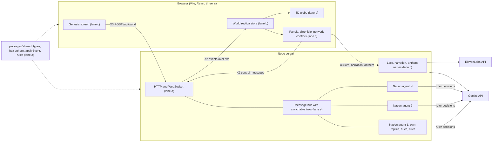

# DurHack 2026 — Terra Nova

*Owner-edited. How the project works lives in `documentation.md`; what's next lives in `roadmap.md`.*

> **Status: kickoff, 14 Nov 2026, 14:30.** Idea chosen by the owner (idea 2, "Worldbuilders",
> in `prizes/matrix.md`). Software only, no hardware.

## 1. The idea

Type one line ("a drowned post-apocalyptic world") and watch a living 3D planet build itself.
Every nation on it is ruled by its own independent AI. The nations settle, build towns, form
ideologies, trade, betray each other and go to war, live, on a globe you can spin, zoom and
click. No central brain runs the world: cut a nation off, silence its ruler or delete it
altogether and the world keeps building; bring it back and its history merges in.

One sentence for judges: **a new world, composed live by AIs that keep working together when
they cannot talk to each other.**

## 2. The demo (2 minutes)

1. A judge gives a prompt. We pick six nations and press Create. A planet forms; six nations are
   named and placed, each with a leader, an ideology and a founding myth. (15 seconds)
2. Time runs at speed. Borders spread across the hex tiles, camps become villages become cities,
   low-poly buildings pop up. A chronicle ticker tells the story as it happens.
3. Zoom into a nation and click it. Its border lights up. A panel shows its culture, politics
   and its history with its neighbours. A voice narrates it; its anthem plays.
4. A war breaks out. Armies march, volleys fly, tiles change colour.
5. **The moment:** open the network panel and cut the link to one nation in the middle of the
   war. It carries on building from what it last knew; a "what it believes" view shows its map
   drifting from the truth; its neighbours notice the silence. Delete a second nation outright:
   its neighbours carve it up. Restore the link: the missing years merge in, the border disputes
   are settled on screen, and the chronicle records "the Silence".
6. Close on the token meter ("this whole world cost N tokens") and the build history in Entire.

Backup plan if live fails: every run is an event log, so a saved run replays exactly, offline,
with no API calls (`row A9`). Narration and anthems for the saved world are cached on disk.

## 3. Prizes we're going for

| Prize | Why we qualify | What it needs from us | Lane / row | Submission field |
| --- | --- | --- | --- | --- |
| Main track (theme: Composition) | A world, its history and its music composed live from parts by several authors | Polish; a "what we learned" section | all / C9 | Main submission |
| Neptune North: Actors work better together | It is their "teams of AI agents" example: common goal, independent decisions, progress when cut off, merge on return | The cut, silence, delete and restore demo; a section headed with their four criteria | a / A4, A7; b / B6; c / C7 | Tick the challenge; show at their stand |
| Marshall Wace: New Worlds | Literally a new world nobody has seen | Open the pitch with "New Worlds"; visit their stand early | c / C9 | Tick the challenge |
| MLH Best Use of ElevenLabs | Narrated histories and a generated anthem per nation | Voice is a core part, not a button | c / C4, C5 | MLH prize tick |
| MLH Best Use of Gemini API | Gemini rules every nation and writes the lore | Name the models and the token budget | a / A5; c / C3 | MLH prize tick |
| MLH Best Use of Entire | Built with agents across three laptops with sessions recorded | Session push on; token numbers on a slide | owner / O2 | MLH prize tick |
| MLH Best Use of Tiger Data (stretch) | The event log is a time series | Hypertable and one live chart | a / A11 | MLH prize tick |
| Waterstons (weak fit) | Connects language models, a simulation, voice and music | One honest line | c / C9 | Tick the challenge |

Not targeted: Arduino/RS and P&G sensors (hardware), SGX FX, Accenture, P&G receipts, QRT.
Full research: `prizes/matrix.md`.

## 4. Architecture

**How the world works (read this before building anything).**

- **The world is an event log.** Nothing is changed in place; every change is an event
  (`tile_claimed`, `structure_built`, `unit_moved`, `battle`, `relation_changed`, `chronicle`
  and so on). `applyEvent(world, event)` in `packages/shared` is the only code that changes a
  world, and the server and the browser both use it. A saved log replays a run exactly.
- **Rules, not the LLM, move the world.** A deterministic simulation ticks once per half second
  (one tick is one year). Growth, claiming land, building, marching and battles are plain code.
  This is what makes it cheap, fast and able to run with no LLM at all.
- **Each nation is an independent agent.** It keeps its own copy of the world (its beliefs),
  decides only for itself, and publishes its events on a message bus. There is no world
  controller. A battle is settled by a pure function of both sides' strength and a seeded hash,
  so every agent computes the same result without a referee.
- **The ruler is an LLM, called rarely.** Every 30 to 45 seconds, or when something big happens,
  a nation sends Gemini a digest of under 400 tokens and gets back under 150 tokens of JSON: a
  focus (expand, develop, fortify, attack), changes of stance towards neighbours, and one
  sentence of proclamation for the chronicle. Between calls the rules carry out the focus.
- **Resilience is three switches per nation.**
  - *Cut link:* the agent keeps running but nothing gets in or out. It acts on stale beliefs and
    queues its events. On restore, both sides exchange what the other missed; clashing claims
    on a tile are settled by a deterministic rule and written into the chronicle as a dispute.
  - *Silence ruler:* no LLM calls. The nation runs on autopilot (its last focus, then a simple
    policy from its temperament). Hitting the token budget triggers the same path.
  - *Delete:* the agent is removed. Neighbours stop hearing its heartbeat, treat its land as
    unclaimed ruins and carve it up.
- **The browser is an observer.** It holds a replica fed by events, renders it, and sends
  control messages. It can also show one nation's beliefs instead of the truth.

**Token budget (Gemini).** Six to eight nations at two ruler calls a minute plus one chronicle
call is about 17 requests and 9,000 tokens a minute, inside the free tier's listed 200 requests
and 50,000 tokens a minute; the daily cap of 10,000 requests is about nine hours of running.
So: `LLM_MODE=mock` is the default for all development and tests, live mode is for demos, a
meter shows calls and tokens, and a hard cap drops every nation to autopilot. Lore is generated
only when a nation is first clicked, and cached. If the free tier turns out tighter than listed
(row A5 checks), the owner has agreed to pay a small amount: a flash-lite model at this volume
is well under five pounds for the weekend.

**Voice budget (ElevenLabs).** Narration and anthems are generated on first click only and
cached on disk by content hash. The demo world's audio is generated once and kept.

- **Stack:** TypeScript everywhere. Node 22, npm workspaces. `packages/shared` (types, hex
  sphere via `hexasphere.js`, `applyEvent`, rules), `server` (Express, `ws`, `@google/genai`),
  `web` (Vite, React, three.js with `@react-three/fiber` and `drei`, `zustand`).
- **Run:** `npm install`, then `npm run dev` (server on 8787, web on 5173). `npm run mock` runs
  the server with a scripted world and no API calls.
- **Hosting for the demo:** the owner's laptop. Stretch: nation agents running on the other two
  laptops (row A10).
- **External services:** Gemini (`GEMINI_API_KEY`), ElevenLabs (`ELEVENLABS_API_KEY`), optional
  Tiger Data (`TIGER_DATABASE_URL`).
- **Assets:** low-poly GLB models made with headless Blender on the owner's laptop (row A8).

**Inputs.** The Create screen takes: a text prompt (required), preset chips (post-apocalyptic,
bronze age, floating archipelago, ice world, and so on), number of nations (3 to 10), an era
dropdown, sea level, and an aggression slider. While the world runs, a "decree" box lets the
judge drop an event on it (a plague, a meteor, a prophet). Stretch: an image as input, read by
Gemini for mood and palette (row C8).

## 5. Lanes

| Lane | Person | Owns (paths) | Delivers |
| --- | --- | --- | --- |
| a · World engine and agents | @SamsSide | `packages/shared/`, `server/` except `server/src/story/`, `assets/`, `web/public/models/`, root config | Types and contracts, world generation, the simulation, nation agents, Gemini rulers, war, resilience, replay, 3D assets |
| b · The globe | @CutGrass88 | `web/` except `web/src/ui/` and `web/public/models/` | The 3D planet, camera, borders, buildings, war animation, status visuals, performance |
| c · Story, sound and interface | @Justin-CODING-PY | `web/src/ui/`, `server/src/story/` | Create screen, nation panel, lore, narration, anthem, chronicle, network controls, submission |

## 6. Schedule

Assumes hacking ends Sunday 12:00 (not confirmed; the QRT CTF ends then). Adjust if told otherwise.

| Time | Checkpoint | Means |
| --- | --- | --- |
| Sat 15:30 | CP0 | Plan merged; scaffold and mock server on `main`; every lane building against the mock |
| Sat 21:00 | CP1 | First end-to-end on `main`: a prompt makes a world, nations grow live on the globe, a click opens a panel |
| Sun 02:00 | CP1.5 | Wars animate; cut, silence, delete and restore work; real lore, narration and anthem |
| Sun 08:00 | CP2 | Feature freeze: fixes, polish, the saved demo world, docs |
| Sun 10:30 | CP3 | Demo rehearsed three times, submitted |
| Sun 12:00 onwards | Judging | Table demo; sponsor stands |

## 7. Risks and cuts

| Risk | If it happens |
| --- | --- |
| The globe is slow with 1,400 tiles, buildings and units | Instanced meshes from the start; fewer tiles (subdivision 10); buildings only when zoomed in |
| Reconciliation after a cut is buggy | Keep cut simple: queue and replay with last-writer-wins on tiles; the dispute story is a stretch |
| Gemini rate limits or bad JSON | Autopilot on any failure (same path as silence); JSON schema output; mock mode |
| ElevenLabs credits or music access | Cache everything; narration first, anthem second; anthem falls back to a short generated tone piece |
| An AI world generator looks generic, others build one too | The resilience demo and the live wars are the difference; rehearse step 5 most |
| Blender assets take too long | Kenney-style CC0 packs or coloured primitive shapes; the manifest (X4) stays the same |

Cut order if behind: image input (C8), Tiger Data (A11), remote agents (A10), beliefs view,
anthem, decree box, fleets, atmosphere polish. Never cut: prompt to world, live growth, click
panel with voice, one war, cut and restore.
