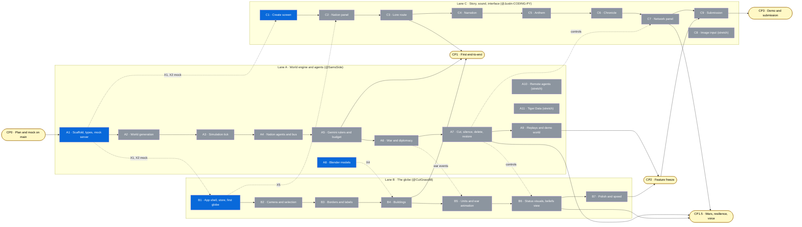

# DurHack 2026 — Roadmap

*What gets built, by which lane, in what order, and the checkpoints where lanes meet.*

> **The owner (SamsSide) edits this file.** Each lane's rows and their status live in
> [`lanes/<lane>.md`](lanes/), which only that lane edits, so four people never fight over one
> table. This file holds the diagram, the checkpoints, *Where we are* and *Up next*.
> Changes from other lanes: a `needs-owner` issue (see `durhack-inbox`).

## Where we are

**Kickoff done, 14 Nov 14:30.** The project is Terra Nova (`hackathon-plan.md`). Contracts X1 to
X5 are agreed. Lane a is building the scaffold and mock server (A1) and the 3D models (A8);
lanes b and c start on the mock as soon as A1 merges.

## Up next, per lane

| Lane | Person | Next row | Waiting on |
| --- | --- | --- | --- |
| a | @SamsSide | A1 scaffold and mock, A8 models | nothing |
| b | @CutGrass88 | B1 app shell, store and first globe | A1 on `main` |
| c | @Justin-CODING-PY | C1 Create screen, C3 lore route | A1 on `main` (C1 also needs B1's app shell) |

## Checkpoints

Assumes hacking ends Sunday 12:00 (not confirmed).

| CP | Time | Means | Status |
| --- | --- | --- | --- |
| CP0 | Sat 15:30 | Plan merged; scaffold and mock server on `main`; every lane building on the mock | wip |
| CP1 | Sat 21:00 | First end-to-end: a prompt makes a world, nations grow live on the globe, a click opens a panel | todo |
| CP1.5 | Sun 02:00 | Wars animate; cut, silence, delete and restore work; real lore, narration and anthem | todo |
| CP2 | Sun 08:00 | Feature freeze: fixes, polish, the saved demo world, docs | todo |
| CP3 | Sun 10:30 | Demo rehearsed three times, submitted | todo |

## The lanes

*One column per person. Dotted arrows are cross-lane needs (contracts X1 to X5).*

Colours: green done, amber in progress, blue next, grey to do, purple owner decision, dashed cut.

## How to update

- **A lane finishes a row:** that lane updates its own `lanes/<lane>.md` in the same PR. It
  does not touch this file.
- **The owner,** every few hours or at a checkpoint: recolour the diagram from the lane files,
  refresh *Where we are*, *Up next* and the checkpoint statuses, in one PR.
- **Adding, cutting or moving a row:** owner only (`durhack-plan` re-plan). Cut rows stay, as
  `cut`, so ids don't move. Log it in `decisions.md`.
