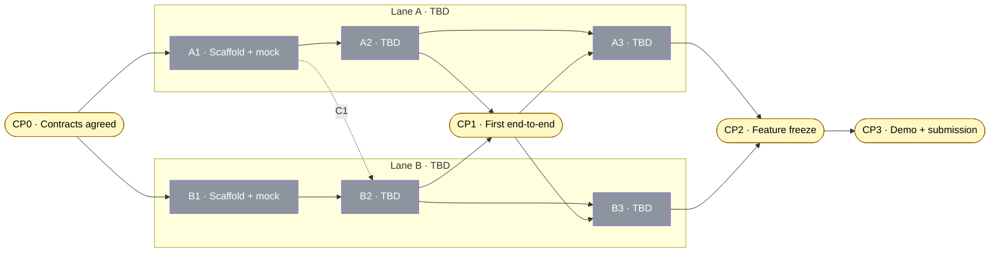

# DurHack 2026 — Roadmap

*What gets built, by which lane, in what order, and the checkpoints where lanes meet.*

> **The owner (SamsSide) edits this file.** Each lane's rows and their status live in
> [`lanes/<lane>.md`](lanes/), which only that lane edits, so four people never fight over one
> table. This file holds the diagram, the checkpoints, *Where we are* and *Up next*.
> Changes from other lanes: a `needs-owner` issue (see `durhack-inbox`).

## Where we are

**Not started.** Next: `durhack-init` (team and lanes), then `durhack-prizes` (research every
prize), then `durhack-plan` kickoff (idea, plan, contracts, rows).

## Up next, per lane

| Lane | Person | Next row | Waiting on |
| --- | --- | --- | --- |
| _set by durhack-init_ | | | |

## Checkpoints

| CP | Time | Means | Status |
| --- | --- | --- | --- |
| CP0 | start + 1–2 h | Idea, prizes, architecture and contracts agreed; every lane builds on mocks | todo |
| CP1 | ~10 h | First end-to-end run on `main`; real pieces replace mocks | todo |
| CP2 | ~18 h | Feature freeze: fixes, polish, docs, judge prep only | todo |
| CP3 | ~22 h | Demo rehearsed, submission done | todo |

## The lanes

*Placeholder for 2 lanes; `durhack-init` redraws it with one column per person, and
`durhack-plan` fills in the rows. Dotted arrows are cross-lane needs (contracts).*

Colours: green done, amber in progress, blue next, grey to do, purple owner decision, dashed cut.

## How to update

- **A lane finishes a row:** that lane updates its own `lanes/<lane>.md` in the same PR. It
  does not touch this file.
- **The owner,** every few hours or at a checkpoint: recolour the diagram from the lane files,
  refresh *Where we are*, *Up next* and the checkpoint statuses, in one PR.
- **Adding, cutting or moving a row:** owner only (`durhack-plan` re-plan). Cut rows stay, as
  `cut`, so ids don't move. Log it in `decisions.md`.
