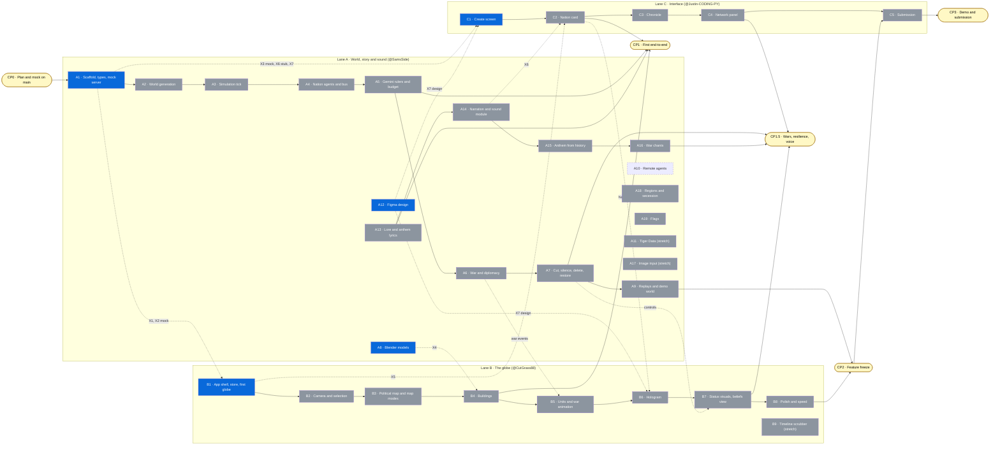

# DurHack 2026 — Roadmap

*What gets built, by which lane, in what order, and the checkpoints where lanes meet.*

> **The owner (SamsSide) edits this file.** Each lane's rows and their status live in
> [`lanes/<lane>.md`](lanes/), which only that lane edits, so four people never fight over one
> table. This file holds the diagram, the checkpoints, *Where we are* and *Up next*.
> Changes from other lanes: a `needs-owner` issue (see `durhack-inbox`).

## Where we are

**Planning, 14 Nov 15:00. Nothing is built yet; building starts when the owner says so.** The
project is Terra Nova (`hackathon-plan.md`). Contracts X1 to X7 are agreed. The work is split by
agent budget: lane a carries the most, lane b a middling amount, lane c the least.

## Up next, per lane

| Lane | Person | Next row | Waiting on |
| --- | --- | --- | --- |
| a | @SamsSide | A1 scaffold and mock; then A8 models and A12 Figma design alongside A2 | the owner's go |
| b | @CutGrass88 | B1 app shell, store and first globe | A1 on `main` |
| c | @Justin-CODING-PY | C1 Create screen, then C2 nation card | A1 and B1 on `main` |

## Checkpoints

Hacking ends Sunday 12:00.

| CP | Time | Means | Status |
| --- | --- | --- | --- |
| CP0 | 1 hour after the owner's go | Scaffold and mock server on `main`; every lane building on the mock | todo |
| CP1 | Sat 21:00 | First end-to-end: a prompt makes a world, nations grow live on the globe, a click opens a panel | todo |
| CP1.5 | Sun 02:00 | Wars animate; cut, silence, delete and restore work; real lore, narration and anthem | todo |
| CP2 | Sun 08:00 | Feature freeze: fixes, polish, the saved demo world, docs | todo |
| CP3 | Sun 10:30 | Demo rehearsed three times, submitted | todo |

## The lanes

*One column per person. Dotted arrows are cross-lane needs (contracts X1 to X7).*

Colours: green done, amber in progress, blue next, grey to do, purple owner decision, dashed cut.

## How to update

- **A lane finishes a row:** that lane updates its own `lanes/<lane>.md` in the same PR. It
  does not touch this file.
- **The owner,** every few hours or at a checkpoint: recolour the diagram from the lane files,
  refresh *Where we are*, *Up next* and the checkpoint statuses, in one PR.
- **Adding, cutting or moving a row:** owner only (`durhack-plan` re-plan). Cut rows stay, as
  `cut`, so ids don't move. Log it in `decisions.md`.
