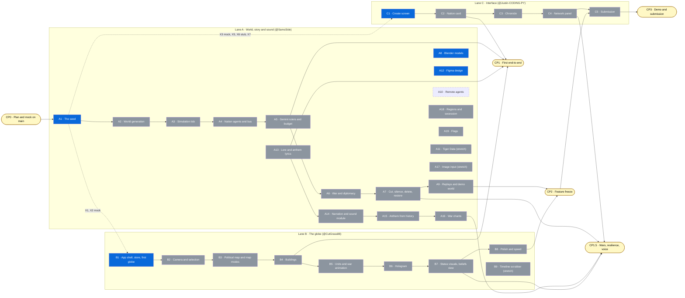

# DurHack 2026 — Roadmap

*What gets built, by which lane, in what order, and the checkpoints where lanes meet.*

> **The owner (SamsSide) edits this file.** Each lane's rows and their status live in
> [`lanes/<lane>.md`](lanes/), which only that lane edits, so four people never fight over one
> table. This file holds the diagram, the checkpoints, *Where we are* and *Up next*.
> Changes from other lanes: a `needs-owner` issue (see `durhack-inbox`).

## Where we are

**14 Nov, 21:15. Built and on `main`; hand testing before CP2 (Sun 08:00).** Every row in
every lane is built (status `testing`) except B8 (frame rate at the top gear, second pass in
flight on `a/perf2`) and #276 (presentation mode and a collapsed-by-default screen, lane c).
Today's big pieces: calm UI with one left panel (#254), a material-system UI depth pass the team
chose to keep (#258 to #268), living world (#252), 1,200 provinces (#240), time gears from
1 week to 10 years a second (#267), the freeze fix and server guards (#255), the memory cap
(#259), a full demo dry run (#274), a UI bug test (#277), devnet payments verified (#270), and
the submission text, video plan and README (#269).

**Open, for people:** the hand tests (#222 lane b CP2 suite; #23, #24, #39, #40, #82 lane c;
#53 war chants), one live rehearsal with Gemini, ElevenLabs and devnet, the `[check]` items in
`docs/submission.md`, and re-recording the demo world on the final build.

## Up next, per lane

| Lane | Person | Next row | Waiting on |
| --- | --- | --- | --- |
| a | @SamsSide | A1 the seed; then four tracks at once (engine, story and sound, models, design) | the owner's go |
| b | @CutGrass88 | Lane plan for B1 to B3 now; build B1 when A1 merges | A1 only (30 minutes) |
| c | @Justin-CODING-PY | Lane plan for C1 and C2 now; build C1 when A1 merges | A1 only (30 minutes) |

## Checkpoints

Hacking ends Sunday 12:00.

| CP | Time | Means | Status |
| --- | --- | --- | --- |
| CP0 | 30 minutes after the owner's go | The seed (A1) on `main`; every lane building on the mock, nobody waiting | todo |
| CP1 | Sat 21:00 | First end-to-end: a prompt makes a world, nations grow live on the globe, a click opens a panel | todo |
| CP1.5 | Sun 02:00 | Wars animate; cut, silence, delete and restore work; real lore, narration and anthem | todo |
| CP2 | Sun 08:00 | Feature freeze: fixes, polish, the saved demo world, docs | todo |
| CP3 | Sun 10:30 | Demo rehearsed three times, submitted | todo |

## The lanes

*One column per person. The only cross-lane dependency is the seed (A1): everything else is
built against the mock and swapped for the real piece when it merges.*

Colours: green done, amber in progress, blue next, grey to do, purple owner decision, dashed cut.

## How to update

- **A lane finishes a row:** that lane updates its own `lanes/<lane>.md` in the same PR. It
  does not touch this file.
- **The owner,** every few hours or at a checkpoint: recolour the diagram from the lane files,
  refresh *Where we are*, *Up next* and the checkpoint statuses, in one PR.
- **Adding, cutting or moving a row:** owner only (`durhack-plan` re-plan). Cut rows stay, as
  `cut`, so ids don't move. Log it in `decisions.md`.
